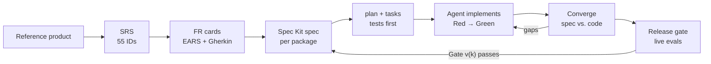
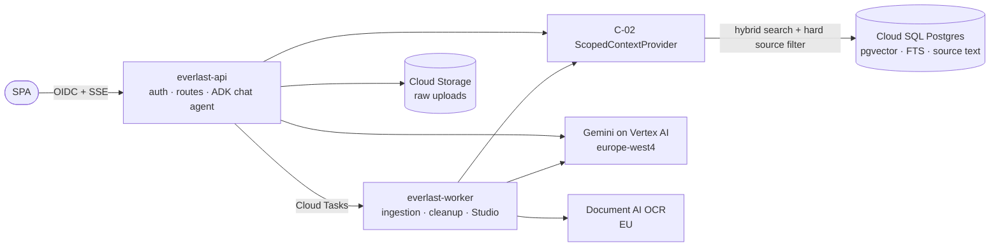

<h1></h1>

**A spec-driven, agent-built re-implementation of Gemini Notebook (formerly NotebookLM) on Google Cloud.**<sup>[1]</sup>

<sub>**[1]** Everlast LM is an independent coding-challenge project. It is not affiliated with, endorsed by, or sponsored by Google, Everlast, or any other trademark owner. "Gemini Notebook" and "NotebookLM" are used only to describe the reference behaviour. All trademarks, copyrights and other intellectual property referenced in this repository belong to their respective owners and are used for identification and descriptive purposes only.</sub>

<p>
  <a href="https://github.com/lukas-zech-software/everlast-lm/actions/workflows/ci.yml"></a>
  <a href="https://github.com/lukas-zech-software/everlast-lm/actions/workflows/spec-integrity.yml"></a>
  <a href="LICENSE"></a>
  <a href="https://github.com/lukas-zech-software/everlast-lm/commits/main"></a>
  <a href="https://github.com/lukas-zech-software/everlast-lm/issues"></a>
  <a href="https://github.com/users/lukas-zech-software/projects/2"></a>
</p>
<p>
  <a href="docs/gate-v1-live-evaluation.md"></a>
  
  
  <a href="spec/System_Requirements_Specification_Gemeni_Notebook.md"></a>
  <a href=".specify/memory/constitution.md"></a>
  <a href="https://github.com/github/spec-kit"></a>
</p>
<p>
  
  
  
  
  
  
</p>

> **The challenge:** *"Build a NotebookLM clone. Implementation, scope and structure are up to you."*
>
> **What I did:** I treated it as a real product rather than a demo. The reference product was first turned into a
> formal requirements specification. A constitution, a binding architecture, release gates, a GitHub roadmap and
> automated infrastructure followed, so that coding agents could build it test-first with little supervision. Then
> agents implemented the first release and passed its quality gate against the live Gemini models. Almost every file
> here was written by coding agents. My job was steering, reviewing and making decisions.

---

## Timeline

Five days, from the first requirements document to a passed v1 release gate. Each phase built on the one before.

| Date | Phase | What was introduced |
| :- | :- | :- |
| 2026-10-15 | 1. Requirements gathering | SRS with 55 requirement IDs, 6 releases and 6 release gates; constitution v1.0.0 |
| 2026-10-16 | 2. Refining the requirements | 53 FR cards (EARS + Gherkin), GitHub roadmap with 89 issues, two audits, decisions D1–D13 |
| 2026-10-17 | 3. Breaking out the infrastructure | Every package mapped to Google Cloud resources; OpenTofu chosen (D14) |
| 2026-10-17 | 4. Lining everything up | Constitution v1.1.0 / v1.2.0 with executable gate checks and flow-back; Spec Kit pipeline and templates |
| 2026-10-17/18 | 5. Infrastructure, automated | OpenTofu modules, policy tests, plan/apply workflow, dev environment provisioned, FinOps tooling |
| 2026-10-18 | 6. First v1 implementation | Spec Kit specs, plans and tasks for packages 1.1–1.4; a 23,000-line implementation PR |
| 2026-10-19 | 7. Convergence and Gate v1.0 | Gap check found the v1 build mostly stubbed; rewrite on real dependencies; constitution v2.0.0; D15; **Gate v1.0 passed** on Vertex AI |
| 2026-10-19 | 8. v2 in parallel | Packages 2.1–2.4 built by parallel sessions and merged; package 3.1 specification under review |

**1. Requirements gathering.** The Gemini web app broke the reference product into functions. That became the
[SRS](spec/System_Requirements_Specification_Gemeni_Notebook.md): six domains, 55 IDs, four measurable quality
metrics, three architectural contracts (`C-01`..`C-03`) and one gate per release. The same day a constitution fixed
the non-negotiables: traceability, test-first, grounding, contracts, gates, and EU data residency.

**2. Refining the requirements.** Each requirement was expanded into an FR card with numbers, states, error cases and
acceptance scenarios. The SRS was turned into a GitHub project with 89 issues. Two audits followed: issues against
the cards (23 drifted issues fixed) and a [consistency audit](docs/requirements-consistency-audit.md) of all
19 packages against SRS, constitution and architecture. Every audit found real contradictions. Their resolutions
became architecture decisions D1–D13 and the deviation log `DEV-01`..`DEV-03`.

**3. Breaking out the infrastructure.** The [architecture](docs/solution-architecture.md) was checked package by
package: which Google Cloud resource each requirement needs, in which region, with which identity. This produced the
v1 resource list (Cloud Run, Cloud SQL with pgvector, Cloud Storage, Cloud Tasks, Secret Manager, Document AI,
Identity Platform) and decision D14, OpenTofu instead of Terraform.

**4. Lining everything up.** Constitution v1.1.0 turned the principles into an 8-point gate table (`CC-01`..`CC-08`)
that every Spec Kit stage checks. Project templates force SRS citations and test-first task order. v1.2.0 added
*flow-back*: what implementation learns must be written back into spec, plan, FR card, SRS or a decision. `AGENTS.md`
gained the rules for parallel agent sessions in separate worktrees.

**5. Infrastructure, automated.** [`infra/`](infra/README.md) holds OpenTofu modules, one release stack and three
environments, all keyless (Workload Identity Federation). A GitHub workflow plans on every PR and applies behind
protected environments. Billable APIs stay off until the owner approves. The dev environment was provisioned in
`europe-west4`, together with scripts that show cost and status and stop the database when it is idle. Three region
assumptions failed here (see [Lessons](#lessons-assumptions-that-did-not-hold)).

**6. First v1 implementation.** Spec Kit produced spec, plan, checklists and tasks for packages 1.1–1.4. One agent
session then delivered all four packages in a single 23,000-line PR. It reported every task done and every test
green.

**7. Convergence and Gate v1.0.** `/speckit-converge` compared the code with the specs and found 29 gaps. The
"database" was in-memory, the login check did not verify signatures, the model adapter invented answers, and the eval
script printed hardcoded passing metrics. All four packages were rebuilt on PostgreSQL, real RS256 tokens, the ADK
chat agent and a real evaluation pipeline, and the earlier evidence was marked as superseded. Constitution v2.0.0
changed how often the expensive model-judged evals run. D15 moved canonical source text into Postgres. The live
evaluation on Vertex AI passed on the third run; the [stakeholder report](docs/gate-v1-live-evaluation.md) explains
the method, the two failed runs and the results.

**8. v2 in parallel.** While v1 was being converged, other sessions specified and implemented the four v2 packages
(workspace comfort, Source Guide and chat control, notes, text reports) and merged them. They were built on the
earlier v1 code, so they have to be re-verified on the converged code base (see [Status](#status-what-is-missing-for-a-first-usable-prototype)).

---

## Contents

1. [At a glance](#at-a-glance)
2. [The approach](#the-approach)
3. [Requirements](#requirements)
4. [The constitution](#the-constitution)
5. [Architecture](#architecture)
6. [Infrastructure](#infrastructure)
7. [Implementation](#implementation)
8. [Quality gates and evaluation](#quality-gates-and-evaluation)
9. [Working with many agents](#working-with-many-agents)
10. [GitHub project and roadmap](#github-project-and-roadmap)
11. [How this repository was built](#how-this-repository-was-built)
12. [Lessons: assumptions that did not hold](#lessons-assumptions-that-did-not-hold)
13. [Repository map](#repository-map)
14. [Status: what is missing for a first usable prototype](#status-what-is-missing-for-a-first-usable-prototype)

---

## At a glance

| Area | State |
| :- | :- |
| **Requirements** | 55 IDs in 6 domains, 3 contracts, 6 releases, 19 packages, 53 FR cards with 150 EARS statements and 96 Gherkin scenarios |
| **Governance** | Constitution v2.0.0: 6 principles, 8 gate checks (`CC-01`..`CC-08`), test-first non-negotiable |
| **Architecture** | 15 decisions (`D1`..`D15`), 3 accepted deviations (`DEV-01`..`DEV-03`) |
| **Infrastructure** | OpenTofu modules + stack + 3 environments; dev environment provisioned in `europe-west4`; app image not deployed yet |
| **v1.0 (MVP)** | Packages 1.1–1.4 implemented; **Gate v1.0 passed** on 2026-10-19 |
| **v2.0** | Packages 2.1–2.4 implemented and merged; re-verification and Gate v2.0 pending |
| **Tests (v1)** | 320 unit/integration tests on real PostgreSQL, 30 browser journeys, 222-case deterministic eval on every PR |
| **Roadmap** | [GitHub project](https://github.com/users/lukas-zech-software/projects/2): 89 issues, 6 milestones |

---

## The approach

Coding agents are fast, but they fill every gap in a requirement with a guess. The cheapest way to get correct
results is to remove the gaps first: analyse the requirements completely, write them down formally, and derive
everything else from that. The newest technology brings back the oldest planning method.



- **The specification is the single source of truth.** Specs, plans, tasks and tests cite a requirement ID. Behaviour
  without an ID is not built.
- **Tests come from the spec, not from the code.** They are written first and seen to fail. They define "done" for an
  unsupervised agent.
- **Completion claims are not evidence.** Phase 7 showed that a green report can hide stubs. A separate convergence
  pass and evidence from real dependencies now decide what counts as done.
- **Every release is a runnable product.** Releases build on each other through stable contracts.

I had worked this way before AI agents existed: at CHECK24 we moved a team from user stories to executable Gherkin
specifications. Agents make it much cheaper, because writing and maintaining the specification is now the fast part.

---

## Requirements

The [SRS](spec/System_Requirements_Specification_Gemeni_Notebook.md) is the index: every function has an ID, every
release has a gate, and the quality targets are measurable. Hallucination below 5 % (`NFR-EVAL-01`), citation
precision of 1.0 (`NFR-EVAL-02`), at least 99 % refusals of out-of-source questions (`NFR-EVAL-03`) and zero leakage
from deselected sources (`NFR-EVAL-04`).

The [FR cards](spec/requirements/README.md) hold the binding detail: limits with numbers, states, error messages and
Gherkin scenarios that become tests. `Unknown` is allowed, guessing is not. An example of the depth needed: a
deselected source must not leak back through *chat history*, a case a simple leakage test would miss.

Cards are reviewed before they are specified, because every detail becomes a test the build must pass. Every review
found real problems: dropped requirements, clashes with decisions, "A or B" wording that cannot be tested. The SRS and
issues are in German (the challenge was set in German); everything else is in English.

---

## The constitution

[`constitution.md`](.specify/memory/constitution.md) overrides every other document and is checked at every Spec Kit
stage through gates `CC-01`..`CC-08`.

| # | Principle | In one line |
| :-: | :- | :- |
| I | Spec Traceability | Everything cites an SRS ID; FR card limits are copied verbatim |
| II | **Test-First (non-negotiable)** | Spec-derived tests fail first; they may not be weakened without an SRS amendment |
| III | Grounding and Scoping | Only selected, ready sources; citations validated before an answer is published |
| IV | Architectural Contracts | `C-01`..`C-03` defined once; breaking changes need an amendment and migration |
| V | Release Gates | v(k+1) is implemented only after Gate v(k) passes |
| VI | Security, Quotas and Residency | Enterprise EU endpoints, no developer API keys, atomic quotas |

Versions so far: 1.0.0 (ratified), 1.0.1 (FR cards binding), 1.1.0 (gate table), 1.2.0 (flow-back), 2.0.0
(model-judged evals once per release gate instead of on every PR).

---

## Architecture

Full document: [`docs/solution-architecture.md`](docs/solution-architecture.md). A lean, serverless TypeScript
monorepo in which everything scales to zero except one Postgres instance.



| Decision | Choice |
| :- | :- |
| D1 Retrieval | pgvector + full-text search with Reciprocal Rank Fusion in Cloud SQL. We own chunk IDs, so citation precision and zero leakage hold by construction |
| D2 Language | TypeScript end-to-end; contracts as shared Zod schemas |
| D3 Residency | EU by default, with a recorded per-service region map |
| D4 Operating model | Cloud Run + one Postgres, scale to zero |
| D5, D7, D8, D10 | Scope changes: `@Notebook` deferred, single-host live voice, no Google Slides export, audio links in v6 |
| D6 Identity | Generic OIDC/SAML through Identity Platform until an IdP is chosen |
| D9, D11, D12 | Deterministic SVG infographics; Docs/Slides import via Drive; large contexts processed over all original chunks |
| D13 Citation validation | An answer is checked completely before it is shown; status events may stream meanwhile |
| D14 IaC | OpenTofu |
| D15 Source text | Canonical page text in Postgres, committed with the chunks, so deletion is immediate and atomic |

Only parts that must make choices are agents (grounded chat, research, note assistant). Ingestion and every Studio
generator are plain deterministic jobs, which keeps latency, cost and randomness down.

---

## Infrastructure

[`infra/`](infra/README.md) is OpenTofu in three layers: domain modules (services, identity, storage, database,
queues, compute), one release stack (`v1_foundation`) and environment roots for `dev`, `staging` and `prod`.
Policy rules, such as a private EU bucket that purges immediately, are checked by `tofu test`.

Everything is keyless. GitHub Actions authenticate through Workload Identity Federation, Cloud Run uses service
accounts, and Cloud SQL uses IAM database login. `opentofu.yml` plans on every PR and applies only from `main` or
behind a protected environment. Enabling a billable API needs the owner's approval.

The dev environment exists: Cloud Run services for API and worker, Cloud SQL Postgres 16 with pgvector, two Cloud
Tasks queues, the bucket, Secret Manager and a Document AI processor. The FinOps scripts (`infra:status`, warm-up,
stopping the database) keep the fixed cost near zero. The database is currently stopped. **Cloud Run still runs
Google's placeholder image**; the application has not been deployed yet.

---

## Implementation

A pnpm monorepo running TypeScript directly on Node 24, without a build step for the backend.

| Part | What it does |
| :- | :- |
| `apps/api` | HTTP API and the SPA host: Identity Platform token checks, notebooks, uploads, grounded chat over SSE |
| `apps/worker` | Ingestion (PDF via pdfjs, OCR via Document AI, chunking, embeddings), deletion cleanup, Studio jobs |
| `apps/web` | Vanilla TypeScript SPA: three-panel workspace, source inspector, chat with clickable citations |
| `packages/contracts` | Zod schemas for `C-01`..`C-03` and the API |
| `packages/db` | PostgreSQL schema and migrations, locking, job outbox, hybrid retrieval (`C-02`) |
| `packages/cloud` | Adapters for Cloud Storage, Vertex AI embeddings and Document AI, with labelled local doubles |
| `packages/evals` | Synthetic corpus, 222-case golden dataset, LLM judge, metrics and gate reports |
| `packages/testkit` | Test-only fixtures, such as a PDF builder |

v1 lets a user sign in, create notebooks, upload PDF, Markdown and text, inspect a source, and ask questions that
are answered only from the selected sources. Every claim carries a numbered citation that scrolls to the exact
passage. If the sources do not contain the answer, the assistant says so. One container image runs as API or worker.
Locally, `pnpm db:test:up` starts Postgres with pgvector in Docker and `pnpm dev` starts API, worker and SPA.

---

## Quality gates and evaluation

Two kinds of checks, with different costs:

- **On every PR** (CI, no cloud access): lint, typecheck, unit and integration tests against real PostgreSQL, browser
  journeys, and the deterministic eval. It runs all 222 golden cases for citation precision and leakage, plus an attack
  run with a model that tries to cite passages it was never given.
- **Once per release gate** (Vertex AI): the model-judged suite. Gemini 2.5 Flash answers, Gemini 2.5 Flash-Lite
  judges hallucination, citation support and refusals, on a fixed, representative 50-case sample. A data-protection
  preflight confirms enterprise endpoints, EU regions and that no developer API key is present.

Gate v1.0 passed on 2026-10-19: 0 % hallucination, 100 % citation precision and support, 100 % refusals, zero
leakage, and citation clicks landing on the exact passage (95th percentile 54 ms). The
[stakeholder report](docs/gate-v1-live-evaluation.md) explains why the live run is needed, how it was done, the two
failed runs before it, and one gap: half of the answerable multi-document questions were declined instead of
answered. Raw evidence: [gate report](specs/004-ui-skeleton-quality-gates/evidence/eval-report-v1.md).

---

## Working with many agents

[`AGENTS.md`](AGENTS.md) is the one manual every agent reads; `CLAUDE.md` imports it and Gemini CLI points at it.

- **One worktree per session.** Every piece of work starts in its own Git worktree and branch, never on `main`.
- **One package per branch.** A release is split into its packages. Dependent packages run one after another, each
  branching from the previous one's result; only independent packages may run in parallel.
- **Pinned feature context.** Each session pins its Spec Kit feature in `.specify/feature.json`, so parallel sessions
  never write into each other's specs.
- **Serialised shared files.** SRS, constitution, architecture, contracts, CI and infrastructure have one owner at a
  time and are merged before dependent work.
- **Pipeline with a final review.** The [pipeline workflow](.specify/workflows/pipeline/workflow.yml) runs
  specify → clarify → plan → tasks → analyze → implement → converge; a
  [verification overlay](docs/spec-kit-workflow-overlays.md) adds a closing convergence check and a human review.

---

## GitHub project and roadmap

The [roadmap project](https://github.com/users/lukas-zech-software/projects/2) was generated from the SRS: one roadmap
issue, 19 package epics, 57 requirement issues, 3 contract issues, 3 technical tasks and 6 gate issues, with one
milestone per release. Each issue carries acceptance criteria, test notes, dependencies and a link to its FR card. An
audit against the later FR cards found and fixed 23 drifted issues. Labels such as `spec-drift` and
`needs-clarification` keep that visible.

---

## How this repository was built

Apart from small tooling files such as `.gitignore`, no file here was written by hand.

| Tool | Used for |
| :- | :- |
| **Gemini** (web app with Canvas) | First breakdown of the reference product into requirement IDs |
| **Antigravity** | Google Cloud resource and architecture design |
| **Codex**, **Gemini CLI**, **OpenCode** (Muse) via ACP in JetBrains Air | Requirements analysis, specs, infrastructure and implementation sessions |
| **GitHub Copilot** | Coding agent and autofix on the implementation and infrastructure PRs |
| **Claude Code** (Opus) | Constitution amendments, card reviews, audits, convergence of v1, the live gate run, commits and PRs |

What made it work: GitHub Spec Kit instead of free-form prompting; one shared `AGENTS.md`; agent skills for repeatable
procedures; MCP servers for live GitHub and documentation context; conventional commits with co-author trailers.
All agents run on personal subscription plans, so long runs happen one after another rather than as a large fan-out.

---

## Lessons: assumptions that did not hold

| Assumption | What happened | What changed |
| :- | :- | :- |
| A green agent report means the work is done | The first v1 PR passed its own tests with in-memory stores, unsigned tokens, invented answers and hardcoded eval metrics | Convergence against the spec, evidence from real dependencies, test doubles labelled in code, earlier evidence marked superseded |
| Release gates are respected because the rules say so | v2 was built and merged while Gate v1.0 was still open, trusting the stubbed eval output | Gates need enforcement in CI and branch rules, not only in documents |
| Parallel sessions integrate cleanly | v2 was built on the pre-convergence v1 code; merging the two touches 21 conflicting files | Strict merge order and rebasing on the latest gate-passing base |
| Judged evals can run on every PR | Too slow and costly, and they need cloud credentials in CI | Constitution v2.0.0: once per release gate on a fixed 50-case sample; deterministic checks stay on every PR |
| A managed RAG service fits | Vertex RAG Engine needed an always-on Spanner instance and had no TypeScript SDK | D1: pgvector + full-text search in the one Postgres |
| Everything runs in `europe-west4` | Cloud Tasks is not offered there; Document AI only in the EU multi-region | Recorded region map (D3): `europe-west1` for queues, `eu` for OCR |
| Source text can live in Cloud Storage | A second purge path, not atomic with publishing a source | D15: canonical text in Postgres |
| The LLM judge is ground truth | It failed correct answers twice: a test PDF rendered "€" as "?", and "its budget" was judged without context | Fixture fixed, claim sentences name their subject, judge sees prior sentences for reference only. Thresholds unchanged |
| Passing the gate means the product answers well | Gate measures safety, not coverage: 7 of 14 answerable multi-document questions were declined | Multi-hop retrieval and an answer-coverage metric are next |
| Developer shells are clean | Consumer Gemini API keys in shell profiles tripped the data-protection preflight | Evals and agents run with those variables unset |

---

## Repository map

```text
everlast-lm/
├── AGENTS.md, CLAUDE.md          ← shared agent manual (worktrees, packages, ownership)
├── spec/                         ← SRS, FR cards per release (v1–v6), evidence of the reference product
├── specs/<NNN>-<package>/        ← Spec Kit output per package: spec, plan, tasks, validation, evidence
├── docs/                         ← architecture (D1–D15), audits, Gate v1.0 report, workflow overlays
├── apps/                         ← api, worker, web
├── packages/                     ← contracts, db, cloud, evals, testkit
├── infra/                        ← OpenTofu modules, release stack, dev/staging/prod roots
├── scripts/                      ← spec integrity check, dev/start/db helpers, infra status and FinOps
├── Dockerfile                    ← one image for API and worker
├── .specify/                     ← constitution, template overrides, pipeline workflow and overlays
└── .github/                      ← CI, OpenTofu workflow, CODEOWNERS, issue templates, Spec Kit skills
```

---

## Status: what is missing for a first usable prototype

v1 works end to end locally and passed its quality gate against the live models. To give a real user a URL to sign
in and work with, these steps remain, in order:

1. **Re-verify v2 on the converged v1 code.** Packages 2.1–2.4 were built and tested against the earlier v1 code
   (in-memory stores, stubbed eval). Their tests must pass on PostgreSQL and the real auth and chat pipeline before
   `main` can be deployed. Gate v2.0 has not run yet.
2. **Build and deploy the application.** The Dockerfile exists, but no image is in Artifact Registry and no workflow
   builds, pushes and rolls it out. Cloud Run still serves the placeholder image. Database migrations must run as part
   of the rollout.
3. **Set up sign-in.** Configure an Identity Platform provider (an OIDC test tenant) and the SPA's client settings,
   then run the open live checks for sign-in, token revocation and bucket purge (001 T046).
4. **Wire the runtime configuration.** Bucket, Document AI processor, Vertex project, Cloud Tasks queue and invoker
   as Cloud Run settings; secrets mounted; Cloud SQL started.
5. **Give CI its cloud identity.** Set the Workload Identity variables so deploys and the release-gate eval run from
   GitHub without personal credentials, then re-run the gate on the merged commit.
6. **Smoke-test the deployed environment.** Upload a PDF, ask a question, click a citation; measure time to first
   answer (target 2.5 s, not gated in v1) and cold starts.
7. **Recommended before real users:** multi-hop retrieval, so questions that chain facts across documents get
   answered, and answer coverage as a reported metric.

---

## License and contributing

Licensed under the [Apache License 2.0](LICENSE). See [`CONTRIBUTING.md`](CONTRIBUTING.md) for the workflow,
[`SECURITY.md`](SECURITY.md) for reporting vulnerabilities, and the [Code of Conduct](CODE_OF_CONDUCT.md).
