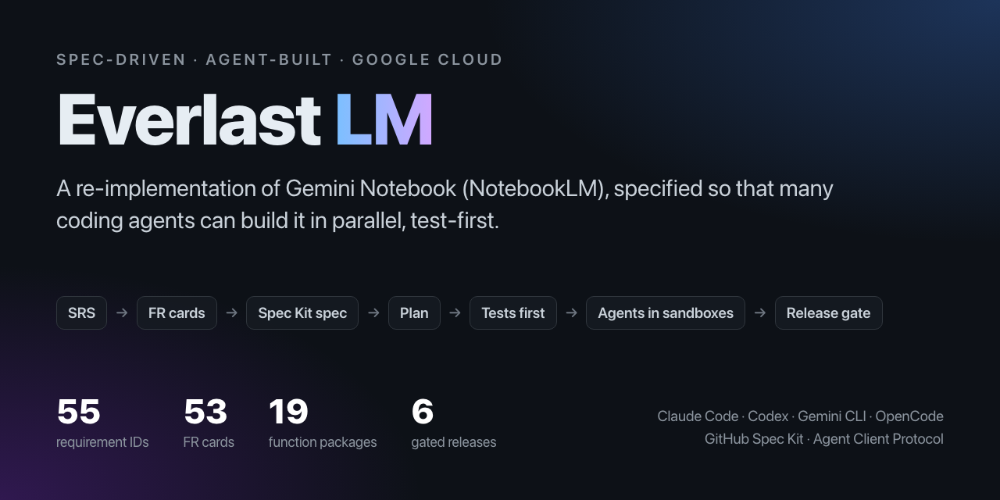
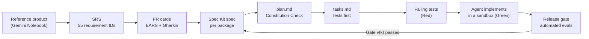
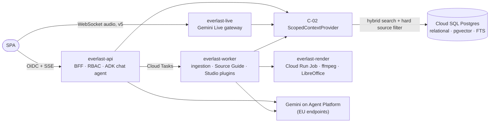

<h1></h1>

**A spec-driven, agent-built re-implementation of Gemini Notebook (formerly NotebookLM) on Google Cloud.**

<p>
  <a href="https://github.com/lukas-zech-software/everlast-lm/actions/workflows/spec-integrity.yml"></a>
  <a href="LICENSE"></a>
  <a href="https://github.com/lukas-zech-software/everlast-lm/commits/main"></a>
  <a href="https://github.com/lukas-zech-software/everlast-lm/issues"></a>
  <a href="https://github.com/lukas-zech-software/everlast-lm/milestones"></a>
  <a href="https://github.com/users/lukas-zech-software/projects/2"></a>
</p>
<p>
  
  
  <a href="spec/System_Requirements_Specification_Gemeni_Notebook.md"></a>
  <a href=".specify/memory/constitution.md"></a>
  <a href="https://github.com/github/spec-kit"></a>
  <a href="https://www.conventionalcommits.org"></a>
</p>
<p>
  
  
  
  
  
  
</p>

> **The challenge:** *"Build a NotebookLM clone. Implementation, scope and structure are up to you."*
>
> **What I did:** I treated it as a real product rather than a demo. First the full reference product was turned into a
> formal requirements specification that coding agents can work from. Then a project constitution, a binding solution
> architecture, release gates and a GitHub roadmap were written so that **several coding agents can implement it in
> parallel, test-first, and with little supervision**. This repository is the result of that phase. Almost every file
> in it was written by coding agents. My job was steering, reviewing and making decisions.

---

## Contents

1. [At a glance](#at-a-glance)
2. [The approach](#the-approach)
3. [Repository map](#repository-map)
4. [Source of truth](#source-of-truth)
5. [Requirements: how deep the specification goes](#requirements-how-deep-the-specification-goes)
6. [The constitution](#the-constitution)
7. [Target architecture](#target-architecture)
8. [Spec Kit workflow](#spec-kit-workflow)
9. [Built for many agents at once](#built-for-many-agents-at-once)
10. [GitHub project and roadmap](#github-project-and-roadmap)
11. [How this repository was built](#how-this-repository-was-built)
12. [Next steps: independent agent sessions in the cloud](#next-steps-independent-agent-sessions-in-the-cloud)
13. [Status: what is missing before implementation starts](#status-what-is-missing-before-implementation-starts)

---

## At a glance

| Area | What is in place |
| :- | :- |
| **Requirements** | 55 traceable IDs (`FR-*`, `NFR-*`) in 6 functional domains, plus 3 architectural contracts (`C-01`..`C-03`) |
| **Releases** | 6 incremental releases (v1.0 MVP to v6.0 Enterprise), 19 function packages, 6 automated release gates |
| **FR cards** | 53 detailed requirement cards: **150 EARS statements**, **96 Gherkin acceptance scenarios**, about 36,000 words |
| **Architecture** | 13 recorded decisions (`D1`..`D13`), 3 documented spec deviations (`DEV-01`..`DEV-03`), 8 tracked risks |
| **Governance** | Constitution v1.0.1 with 6 principles, test-first marked non-negotiable |
| **Agent tooling** | GitHub Spec Kit installed for Claude Code, Codex and GitHub Copilot; one shared `AGENTS.md` |
| **Roadmap** | [GitHub project](https://github.com/users/lukas-zech-software/projects/2) with 89 issues, 6 milestones, 3 views |
| **Application code** | None yet, on purpose. See [Status](#status-what-is-missing-before-implementation-starts) |

---

## The approach

Coding agents are fast and consistent, but they fill every gap in a requirement with their own guess. The cheapest way
to get correct results from them is to remove the gaps first. That means a classic, almost waterfall-like order:
analyse the requirements completely, write them down formally, and derive everything else from that document. It is a
little ironic that the newest technology brings back the oldest planning method.

The pipeline this repository is built for:



Key ideas:

- **The specification is the single source of truth.** Specs, plans, tasks and tests must cite a requirement ID.
  Behaviour that cannot be traced to an ID is not built.
- **Tests come from the spec, not from the code.** For every requirement, spec-derived tests are written and seen to
  fail before any implementation starts. They prove that an unsupervised agent built the right thing.
- **Agents run in sandboxes.** Because the tests define "done", an implementation agent can run with relaxed
  permissions, but only in an isolated sandbox without production credentials.
- **Every release is a runnable product.** The six releases build on each other through stable contracts, so a later
  release never has to break an accepted one.

I had worked this way before AI coding agents existed: at CHECK24 we moved a development workflow from user stories to
executable Gherkin specifications. Agents make the approach much cheaper, because writing and maintaining the
specification is now the fast part.

> **A note on scope and cost.** The challenge set no limits on scope or time. I used that freedom to use current
> technology (ADK for TypeScript, Gemini on Agent Platform, pgvector hybrid search) and to evaluate tools I had wanted
> to try for a while. For a real client project, parts of this would need a separate evaluation, because some Google
> Cloud agent components are still in beta and running costs were not optimised beyond "scale to zero".

---

## Repository map

```text
everlast-lm/
├── README.md                     ← you are here
├── AGENTS.md                     ← shared operating manual for every coding agent (workflow, ownership, isolation)
├── CLAUDE.md                     ← imports AGENTS.md, plus one Claude-specific rule
├── spec/
│   ├── System_Requirements_Specification_Gemeni_Notebook.md   ← SRS: index of all requirement IDs and release gates
│   ├── requirements/
│   │   ├── README.md             ← how FR cards are written (11 fields to extract per requirement)
│   │   ├── _fr-card-template.md  ← EARS + Gherkin card template
│   │   └── v1/ … v6/             ← one file per function package, one card per requirement (19 files, 53 cards)
│   └── evidence/                 ← screenshots and recordings of the reference product, per FR
├── docs/
│   └── solution-architecture.md  ← binding technical choices, decisions D1–D13, risks, release mapping
├── scripts/
│   └── check-spec-integrity.mjs  ← CI check: every link and anchor resolves, every SRS ID has an FR card
├── .specify/                     ← GitHub Spec Kit
│   ├── memory/constitution.md    ← project constitution (overrides everything)
│   ├── templates/overrides/      ← repo customisations of Spec Kit templates (test-first tasks template)
│   ├── scripts/bash/             ← Spec Kit helper scripts (managed)
│   └── integrations/             ← install manifests for Claude, Codex and Copilot
├── .claude/skills/speckit-*      ← Spec Kit commands for Claude Code
├── .agents/skills/speckit-*      ← … for Codex
└── .github/
    ├── skills/speckit-*          ← … for GitHub Copilot
    ├── workflows/                ← CI (spec integrity), actions pinned to commit SHAs
    ├── ISSUE_TEMPLATE/           ← spec change request form
    └── CODEOWNERS                ← owner review for the serialised shared files
```

The SRS and the GitHub issues are in German, because the challenge was set in German. FR cards, architecture,
constitution and every generated spec are in English.

---

## Source of truth

Agents get a strict order of precedence, so that no conflict has to be resolved by guessing:

| Rank | Document | Binding for |
| :-: | :- | :- |
| 1 | [`.specify/memory/constitution.md`](.specify/memory/constitution.md) | Principles and process. Overrides everything. |
| 2 | [SRS](spec/System_Requirements_Specification_Gemeni_Notebook.md) | **What** is built: all IDs, contracts, release packages and gates |
| 3 | [FR cards](spec/requirements/README.md) | The detail of each requirement (limits, states, errors, acceptance scenarios) |
| 4 | [Solution architecture](docs/solution-architecture.md) | **How** it is built: decisions `D1`..`Dn` |

Changes follow fixed rules. New scope is added as an SRS amendment. Removing or deferring scope needs a recorded
architecture decision. A deliberate difference from the reference product is logged twice: as a `DEV-xx` entry in SRS
§5.5 and as the matching `Dn` decision. IDs are never renumbered.

---

## Requirements: how deep the specification goes

### Layer 1: the SRS (index)

The [SRS](spec/System_Requirements_Specification_Gemeni_Notebook.md) breaks the product into six domains (Workspace,
Ingestion, Grounded Chat, Notes, Studio, Ecosystem/UI) and gives every function an ID. It also defines:

- **Formal quality metrics** that can be evaluated automatically: hallucination rate < 5 % (`NFR-EVAL-01`),
  citation-ID precision = 1.0 (`NFR-EVAL-02`), correct refusal of out-of-source questions ≥ 99 % (`NFR-EVAL-03`), and
  zero leakage from deselected sources (`NFR-EVAL-04`).
- **Three architectural contracts** that are fixed early so later releases cannot break earlier ones:
  `C-01 UnifiedDocumentChunk`, `C-02 ScopedContextProvider` (the only path to source content), and
  `C-03 StudioGeneratorPlugin` (every Studio feature is a plugin; open-closed).
- **Six release gates** with concrete automated acceptance criteria. Implementation of v(k+1) may not start before
  Gate v(k) passes.
- **A deviation log** (§5.5) for accepted differences from the reference product.

### Layer 2: FR cards (binding detail)

Each requirement is expanded into a card that `/speckit-specify` can turn into a spec without inventing anything.
Every card has the same structure:

| Section | Content |
| :- | :- |
| Header table | Release and package, priority, actors (including roles that only arrive in v6), dependencies, date observed |
| **Requirement (EARS)** | Ubiquitous, event-driven, state-driven and unwanted-behaviour statements |
| User story and reference behaviour | Numbered steps as observed in the reference product, with evidence links |
| Inputs and limits | Fields, formats, sizes and defaults, **with numbers** |
| Outputs and state | What is visible, what is persisted, state transitions |
| **Acceptance criteria (Gherkin)** | Scenarios that become spec-derived tests |
| Edge and error cases | Empty, too large, concurrent, deleted meanwhile; exact messages where they matter |
| Measurable criteria | Thresholds tied to gate criteria (for example "TTFT ≤ 2.5 s P95 over 20 runs") |
| Deviations, out of scope, open questions | `Unknown` is allowed, guessing is not; at most 3 open questions per package |

A short excerpt from [`FR-GC-01`](spec/requirements/v1/package_1_3_grounded_chat_citation_engine.md#fr-gc-01--strict-grounding-policy):

> *Unwanted:* If a previous turn in the conversation history cites a source that is not in the current S_aktiv, then
> the system shall exclude that turn (question and answer) from the context of the new turn, so that content from
> deselected sources cannot re-enter the prompt via history (`NFR-EVAL-04`).

This is the level of detail a test generator needs. A naive implementation would pass a simple leakage test and still
leak through chat history.

### Layer 3: review before specification

Once a card is specified, every detail in it becomes a test that the build must pass. So each release's cards are
reviewed before `/speckit-specify` runs on them. The review looks for contradictions (between cards, SRS, constitution
and architecture), impossible or untestable statements, and format problems. Every batch reviewed so far had real
findings: requirements dropped during card writing, clashes with architecture decisions, and "A or B" wording that
cannot be tested. All 19 packages have now been reviewed and reconciled; the
[requirements consistency audit](docs/requirements-consistency-audit.md) lists every correction per package.

---

## The constitution

[`constitution.md`](.specify/memory/constitution.md) (v1.0.1) is the guardrail every Spec Kit stage checks against:

| # | Principle | In one line |
| :-: | :- | :- |
| I | Spec Traceability | Every spec, plan, task and test cites an SRS ID; untraceable behaviour is not built |
| II | **Test-First (non-negotiable)** | Spec-derived tests precede implementation, must fail first, and may not be weakened without an SRS amendment |
| III | Grounding and Scoping | Answers only from active sources; citation IDs validated in code; deterministic eval suites on every PR |
| IV | Architectural Contracts | `C-01`..`C-03` defined once as shared typed schemas; breaking changes need amendment and migration |
| V | Release Gates | v(k+1) implementation waits for Gate v(k); every release is runnable |
| VI | Security and Data | Enterprise model endpoints only (no training on customer data), server-side authorisation, EU by default |

It also fixes the platform (TypeScript end-to-end, Google Cloud, Gemini via enterprise endpoints) and requires a
recorded decision with alternatives before any new framework, datastore or fixed-cost component is added.

---

## Target architecture

Full document: [`docs/solution-architecture.md`](docs/solution-architecture.md). In short: a **lean, serverless
TypeScript monorepo** in which everything scales to zero except one Postgres instance.



| # | Decision | Choice |
| :- | :- | :- |
| D1 | Retrieval | pgvector + Postgres full-text search with Reciprocal Rank Fusion in the one Cloud SQL instance. We own chunk IDs and locators, so citation precision and zero leakage hold by construction. (Revised from RAG Engine, which needed an always-on Spanner instance.) |
| D2 | Language | TypeScript end-to-end; contracts are shared Zod schemas in `packages/contracts` |
| D3 | Residency | EU (`europe-west4`) by default; exceptions in a per-feature region map |
| D4 | Operating model | Cloud Run + one Postgres, scale to zero; Cloud SQL is the only fixed cost |
| D5 | `@Notebook` integration | Deferred (`DEV-03`); Gate v6.0 #3 is not part of v6.0 acceptance; the chat agent stays A2A-ready |
| D6 | Identity | Generic OIDC/SAML via Identity Platform until an IdP is chosen |
| D7 | Live "Join-In" voice | Accepted deviation `DEV-01`: one designated host answers live questions |
| D8 | Google Slides export | Deferred (`DEV-02`): `.pptx` and `.pdf` only, because Slides needs per-user OAuth |
| D9 | Infographics | Deterministic SVG from a structured layout, no image model, so numbers stay traceable |
| D10 | Audio link sharing | Moved to v6.0, because share-link access depends on the v6 sharing roles; v5.0 ships player and export |
| D11 | Google Docs/Slides import | Delegated v3 import through the Office normalization path; Google Slides output export stays deferred |
| D12 | Large Studio contexts | Process all original scoped chunks in bounded batches; summaries alone are not lossless evidence |
| D13 | Citation validation | Validate complete factual answers before publication or live speech; progress events do not count as TTFT |

A design choice worth pointing out: the platform's "agents" from the SRS were sorted into **truly agentic** components
(grounded chat, research, note assistant: ADK `LlmAgent` with tools) and **deterministic pipelines** (ingestion, every
Studio generator, rendering: plain job handlers with structured output). That keeps latency, cost and
non-determinism down where the model does not need to choose its own steps.

---

## Spec Kit workflow

[GitHub Spec Kit](https://github.com/github/spec-kit) drives all feature work. One function package from the SRS
becomes one Spec Kit feature, owned by one session for its whole lifecycle:

```text
/speckit-specify spec/requirements/v1/package_1_1_workspace_foundation.md
  → /speckit-clarify   (only if clarification markers remain)
  → /speckit-plan
  → /speckit-tasks
  → /speckit-analyze
  → /speckit-implement
```

| Stage | Exit criterion before the next stage |
| :- | :- |
| Specify / clarify | English spec grounded in the package's FR cards, every requirement citing its SRS ID, no open markers |
| Plan | Constitution Check passes before research **and** after design; dependencies, shared contracts and file boundaries are explicit |
| Tasks | Spec-derived test tasks come before the implementation tasks they cover; dependencies and file paths recorded; `[P]` only for truly independent tasks |
| Analyze | Spec, plan and tasks reviewed together; constitution violations and blocking coverage or contract conflicts resolved |
| Implement | Tests run and fail for the right reason first, then Green → Refactor |

Customisations on top of stock Spec Kit:

- **Multi-agent install.** Spec Kit 1.2.1 is installed for Claude Code (`.claude/skills`), Codex (`.agents/skills`)
  and GitHub Copilot (`.github/skills`), so any of them can run any stage.
- **Stricter sequence than the bundled workflow.** The bundled `.specify/workflows/speckit/workflow.yml` skips clarify
  and analyze. `AGENTS.md` makes both mandatory.
- **Test-first template.** The stock tasks template marks tests as optional, which contradicts Principle II. A
  project override in [`.specify/templates/overrides/tasks-template.md`](.specify/templates/overrides/tasks-template.md)
  makes them mandatory and survives Spec Kit upgrades (managed files are listed in `.specify/integrations/*.manifest.json`
  and are never edited directly).
- **Single requirement source.** The global "brainstorm → plan" workflow some agents bring with them is explicitly
  turned off for this repository, so there is exactly one path from requirement to code.

---

## Built for many agents at once

[`AGENTS.md`](AGENTS.md) is the one operating manual that every agent reads (Codex and OpenCode read it natively,
`CLAUDE.md` imports it, and `.gemini/settings.json` points Gemini CLI at it). Besides the workflow, it covers what
goes wrong when several autonomous sessions share one repository:

- **Isolation.** Every writing session gets its own Git worktree and branch. A second terminal in the same checkout
  does not count. Sessions never switch branches, stash, reset or clean in another session's checkout, and only remove
  worktrees they own.
- **Ownership and claims.** Work is assigned through a shared, visible record (issue or PR description) that names the
  owner, spec path, task IDs, allowed files, branch, base commit, dependencies and acceptance checks. There is one owner
  per task and per shared file at a time, and ownership is handed over explicitly.
- **Splitting a package.** Only after `/speckit-analyze`, with fixed interface contracts and disjoint file ownership.
  The package owner keeps the canonical `tasks.md`, integrates worker results and marks tasks done only after
  verifying them. Task IDs are always qualified by spec path, because `T001` is not unique across features.
- **Pinning Spec Kit to a session.** Spec Kit resolves the active feature from `SPECIFY_FEATURE_DIRECTORY`, then from a
  local pointer file, and not from the Git branch. Sessions therefore set `SPECIFY_INIT_DIR` and
  `SPECIFY_FEATURE_DIRECTORY` explicitly, verify the resolved paths with `check-prerequisites.sh --paths-only` before
  writing, and use `SPECIFY_FEATURE_NO_PERSIST=1`. Feature numbers are allocated centrally, because parallel worktrees
  would otherwise pick the same next number.
- **Serialised shared files.** SRS, constitution, architecture decisions, `AGENTS.md`, Spec Kit config, shared
  contracts, root manifests and lockfile, CI and infrastructure each have exactly one owner at a time and are merged
  before dependent work starts. Database migration order is a shared dependency.
- **Runtime isolation.** Parallel dev servers, test databases and cloud test resources get distinct names and ports.
  There are no competing migrations or Terraform runs against shared state. Agents with relaxed permissions run in
  sandboxes without production credentials, because a worktree is not a sandbox.
- **Integration and handoff.** Everything merges through a scoped PR, in dependency order, after re-checking the diff
  against its base. Conflicts are resolved by the source-of-truth ranking, never by picking a side. A handoff lists
  branch, commit, completed and remaining task IDs, validation results, blockers and the next valid Spec Kit stage,
  and keeps committed, integrated and verified work apart.
- **Release gates still apply.** Specifying and planning later releases may run ahead, but worktrees do not waive the
  rule that v(k+1) is implemented only after Gate v(k).

---

## GitHub project and roadmap

**[Everlast LM – Produkt-Roadmap](https://github.com/users/lukas-zech-software/projects/2)** makes the plan
visible and gives agents an assignable unit of work. It was generated from the SRS.

| Issue type | Count | Issues | Purpose |
| :- | :-: | :- | :- |
| Roadmap | 1 | #1 | Overview of all releases and their dependencies |
| Package epics | 19 | #2–#20 | One per function package, with its requirements and contracts as **sub-issues** |
| Requirements | 57 | #21–#77 | One per SRS ID (`FR-SI-01` and `FR-WM-07` are split across two releases), each with acceptance criteria, test notes and dependencies |
| Architecture contracts | 3 | #78–#80 | `C-01`, `C-02`, `C-03` |
| Technical tasks | 3 | #81–#83 | Derived platform work, such as auth and persistence |
| Release gates | 6 | #84–#89 | One per release; the gate criteria as checklist, depending on every requirement of that release |

- **Milestones:** six, one per release (v1.0 MVP to v6.0), each accepted through its gate issue.
- **Issue bodies:** goal, release and package, link to the specification baseline, acceptance criteria as a checklist,
  test and evidence notes, dependencies on other issues, and the release gate the issue counts towards.
- **Custom fields:** Release, Funktionspaket (package), Domäne (domain), Arbeitstyp (work type), Status.
- **Views:** release overview (table), status board (kanban), package epics by release.
- **Labels:** `type:*`, `domain:*`, `needs-clarification` and `spec-drift`.

The issues were generated from the first SRS baseline. The FR cards and later architecture decisions came afterwards, so a full audit
compared all 89 issues against the current specification. **All 55 requirement IDs are covered.** The audit flagged 23
issues as `spec-drift`, and all 23 are now resolved: open questions that the FR cards answer were written into the
issues, criteria that contradicted decisions were aligned (D7 single-host Join-In, D8 no Google Slides export, D10 link
sharing in v6.0), and the deferred `@Notebook` integration (D5 / DEV-03) is labelled `status:deferred` and removed from
the v6.0 gate. Every issue and milestone links to its current SRS section and FR card on `main`. At that audit baseline, six issues retained
`needs-clarification` for planning questions such as analytics data retention. The subsequent
[requirements consistency audit](docs/requirements-consistency-audit.md) updates the source specifications;
its new acceptance details must be reconciled when deriving Spec Kit tasks and refreshing issue criteria.

---

## How this repository was built

Apart from small tooling files such as `.gitignore`, **no file in this repository was written by hand.** All
requirements analysis, specification, review, architecture, Git and GitHub work was done by coding agents that I
directed, reviewed and corrected.

| Tool | Connected via | Used for |
| :- | :- | :- |
| **Gemini** (web app with Canvas) | Browser | First breakdown of the reference product into functions and requirement IDs, which became the SRS baseline |
| **Antigravity** (Google's agentic IDE) | Native Google Cloud integrations | Drafting the Google Cloud resource and architecture design |
| **WebStorm + JetBrains Air** | IDE; Air is the agent client | Hosting the agents below in the IDE through the **Agent Client Protocol (ACP)** |
| **Codex** | ACP in JetBrains Air | Requirements analysis, architecture, focused editing tasks |
| **Gemini CLI** | ACP in JetBrains Air | Analysis and editing tasks |
| **OpenCode** with the **Muse** model | ACP in JetBrains Air | Analysis and editing tasks |
| **Claude Code** (Opus) | Terminal (the only agent driven directly from the shell) | Constitution amendments, FR card reviews, architecture revisions, `AGENTS.md`, issue audit, commits |

Techniques that made this work:

- **Specification-first, gated workflow** (GitHub Spec Kit) instead of free-form prompting.
- **Agent skills** for repeatable procedures: Spec Kit commands for three agents, plus Google Cloud architecture skills
  for the solution design.
- **Model Context Protocol (MCP) servers** for live context: GitHub (issues, project), Gemini API documentation,
  library documentation, and the IDE.
- **One shared instruction file** (`AGENTS.md`) instead of a separate prompt per agent, so every agent follows the same
  rules.
- **Conventional commits** with co-author trailers, so the history shows which work was agent-generated.

The specification phase so far has taken two days (first commit on 2026-10-15).

---

## Next steps: independent agent sessions in the cloud

`AGENTS.md` already defines the rules for parallel sessions on one machine. To run many sessions independently on
cloud instances, the coordination has to move from local conventions into GitHub, where it can be enforced. Spec Kit
is a GitHub project, and GitHub already provides the needed building blocks:

1. **Shared prerequisites first.** Scaffold the pnpm monorepo, publish `packages/contracts` (`C-01`..`C-03` as Zod
   schemas) and the database migration baseline. Every parallel package depends on these, so they are merged before
   any fan-out.
2. **CI as the enforced gate.** A first workflow already runs on every PR and blocks merges into `main`: it checks
   that every link and anchor in the specification resolves and that every SRS ID has an FR card. Next come lint,
   type-check, unit, contract and the deterministic eval suites (`NFR-EVAL-02/04`) on every PR. The LLM-judged suites (`NFR-EVAL-01/03`) run on path filters for retrieval, prompt
   and chat code, and before every release gate. The existing `main` ruleset then requires these checks as well.
3. **Issues as the claim and handoff record.** Each Spec Kit task slice becomes an issue (`/speckit-taskstoissues` or a
   small script) carrying the `AGENTS.md` assignment fields: spec path, task IDs, allowed files, base commit,
   dependencies and acceptance checks. The assignee is the claim. Sub-issues and native issue dependencies (today the
   dependencies are listed in the issue text) express order, and the project's Status field shows progress.
4. **Cloud agents pick up issues.** An issue is assigned to a cloud coding agent: GitHub Copilot coding agent, Codex
   cloud tasks, Claude Code through GitHub Actions or on the web, or the Gemini CLI GitHub Action. Each runs in an
   ephemeral sandbox on its own branch and ends with a PR. Environment setup is defined once
   (`copilot-setup-steps.yml` or a dev container), so every agent sees the same toolchain.
5. **Ownership enforced, not just agreed.** `CODEOWNERS` for the serialised shared files (SRS, constitution,
   architecture, contracts, CI, `infra/`), so changes there need the package owner's review. A **merge queue**
   integrates PRs in dependency order and re-runs checks on the combined result.
6. **Central feature allocation.** One coordinator issue per release reserves `specs/NNN-<package>` directory names and
   branch names before `/speckit-specify` runs, which removes the numbering race between parallel sessions.
7. **Credential-free cloud access.** GitHub OIDC with Workload Identity Federation for Google Cloud, so there are no
   stored keys. Each PR gets its own test database (for example Postgres with pgvector in a container) and resource
   names prefixed by branch. Terraform `apply` runs only from `main`, with state locking.
8. **Release gates as workflows.** The gate issues (#84–#89) are closed by a gate workflow that runs the full eval
   suite against a staging environment, protected by a GitHub environment with required reviewers.

---

## Status: what is missing before implementation starts

**Done:** SRS, constitution, solution architecture, 53 FR cards, the deviation log, the Spec Kit setup for three agents,
the multi-agent rules in `AGENTS.md`, the GitHub project with 89 issues, and an issue-versus-spec audit.

**Still to do, in order:**

1. **Requirements consistency audit: complete.** All 19 packages / 53 cards have been reviewed against the
   constitution, SRS and architecture, including deferred package 6.3. Corrections cover source scoping,
   permissions, quotas, lifecycle, limits, contracts and gate criteria; see the
   [package-by-package audit](docs/requirements-consistency-audit.md).
2. **Carry the corrected acceptance criteria into planning.** The shared card rules apply to every package.
   Runtime feasibility and performance remain to be established by the specified spikes and release tests.
3. **Run the Spec Kit stages for v1.** `/speckit-specify` → clarify → plan → tasks → `/speckit-analyze` (the
   verification pass across spec, plan and tasks), once for each of packages 1.1 to 1.4. This produces the concrete, test-first task lists that implementation agents need. No
   `specs/` directory exists yet.
4. **Shared prerequisites:** the monorepo scaffold, the contracts package and CI from the [next steps](#next-steps-independent-agent-sessions-in-the-cloud),
   plus the two-day ADK-for-TypeScript spike (risk R3) and a local pgvector prototype with an `NFR-EVAL-04` leakage
   test.
5. **Link the GitHub issues to Spec Kit features.** Reconcile issue criteria with this requirements audit; once `/speckit-specify` runs, each epic links to its `specs/NNN-…` feature directory.
6. **Approve the cloud setup:** enable the v1 Google Cloud APIs (`aiplatform`, `sqladmin`, `cloudtasks`,
   `secretmanager`, `identitytoolkit`, `documentai`) and write the Terraform baseline.

Once steps 1 to 4 are done for a package, implementation agents can start on it in parallel, each in its own sandbox.

> **Why this is progressing step by step.** All agents here run on personal subscription plans, not on API billing.
> Usage windows and rate limits mean the long review and specification runs happen one after another rather than as a
> large parallel fan-out. The process and the repository are designed for that fan-out. The budget is the only thing
> holding it back.

---

## License and contributing

Licensed under the [Apache License 2.0](LICENSE). See [`CONTRIBUTING.md`](CONTRIBUTING.md) for the workflow,
[`SECURITY.md`](SECURITY.md) for reporting vulnerabilities, and the [Code of Conduct](CODE_OF_CONDUCT.md).

---

<sub>Everlast LM is an independent coding-challenge project. It is not affiliated with Google. "Gemini Notebook" and
"NotebookLM" are used only to describe the reference behaviour.</sub>
