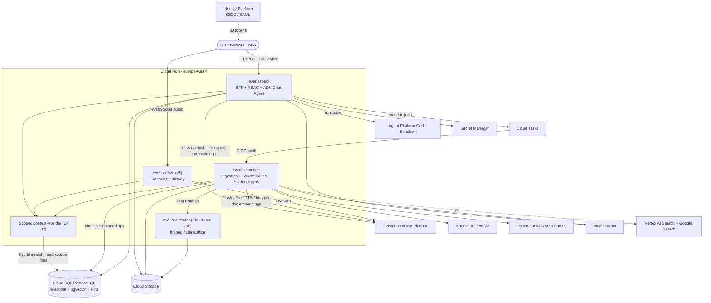

# Google Cloud solution architecture: Everlast LM

> **Status:** Accepted baseline (binding for technical choices per Constitution: Platform Constraints); open risks in §6. This covers Phase 1 (requirements and decomposition) and Phase 2 (solution design) of the `google-cloud-solution-build-deploy-agents` workflow.
> **Source of truth:** [`spec/System_Requirements_Specification_Gemeni_Notebook.md`](../spec/System_Requirements_Specification_Gemeni_Notebook.md)
> **GCP project:** `PROJECT_ID` (e.g. `everlast-lm-dev`)

### Decisions

*Taken 2026-10-15, revised 2026-10-16. IDs are stable; superseded decisions are marked, never renumbered.*

| # | Decision | Choice |
| :- | :- | :- |
| D1 | Retrieval | **pgvector + Postgres full-text search in the existing Cloud SQL instance** (hybrid search). We own chunking, chunk IDs and locators. *(Revised 2026-10-16: replaces RAG Engine, which needed an always-on Spanner instance and had no TypeScript SDK.)* |
| D2 | Backend language | **TypeScript end-to-end** (SPA and backend share one codebase) |
| D3 | Data residency | **EU preferred** (`europe-west4`, or `europe-west3`). Global endpoints are allowed for features not yet available in the EU |
| D4 | Operating model | **Lean serverless**: Cloud Run plus one Postgres, with as few managed extras as possible |
| D5 | FR-INT-01 (`@Notebook`) | Out of scope for now. The design stays A2A-ready |
| D6 | Identity | No IdP chosen yet, so the design uses **generic OIDC/SAML** |
| D7 | FR-ST-03 Join-In voice | **Accepted deviation from the spec** (SRS §5.5 DEV-01): only one host (in that host's voice) answers live interruptions, then the podcast resumes. See §6 |
| D8 | FR-ST-16 Google Slides export | **Deferred** (SRS §5.5 DEV-02): v4 exports `.pptx` and `.pdf` only. Google Slides needs per-user OAuth |
| D9 | FR-ST-17 Infographics | **Deterministic structured-layout-to-SVG rendering only**, with PNG export. No image generation model, so text and numbers stay legible and traceable |

---

## 1. Executive summary and workload overview

Everlast LM is a company-internal workspace for source-grounded research, modelled on Gemini Notebook / NotebookLM. Users upload sources, chat with strictly grounded answers that carry clickable citations, and generate Studio artifacts (reports, mind maps, quizzes, podcasts and videos). The spec delivers this in six releases (v1.0 to v6.0).

**Proposed architecture in one paragraph:** A TypeScript monorepo deployed as a small set of **Cloud Run** services that scale to zero. **ADK for TypeScript (`@google/adk`)** is the only agent framework, used for the agentic parts: grounded chat, note assistant, and research agents. **`@google/genai`** handles media and real-time primitives (TTS, Live API, image and video generation). **Gemini on Gemini Enterprise Agent Platform** (formerly Vertex AI) is the model runtime, using EU regional endpoints. **Cloud SQL for PostgreSQL** is the single store for workspace data, chat history, notes, artifact metadata and learning progress. It is **also the retrieval index**: chunks, embeddings (`pgvector`, HNSW) and full-text vectors (`tsvector`) live in one `chunks` table. Retrieval is a hybrid search with a hard SQL filter on the selected sources. **Cloud Storage** holds raw files and generated media. **Cloud Tasks** and **Cloud Run Jobs** run the asynchronous Studio and ingestion jobs. **Identity Platform** provides OIDC/SAML SSO.

---

## 2. Requirements and current state

### 2.1. Functional requirements (condensed; IDs refer to the SRS)

* **Workspace (FR-WM-01..07):** Notebook CRUD, metadata, sorting and pinning, strict per-notebook isolation, role-based sharing (Owner/Editor, Viewer, Chat-only), analytics, and quotas (≤ 300 sources per notebook, ≤ 500k words / 200 MB per source).
* **Ingestion (FR-SI-01..07):** PDF (with OCR, layout and tables), TXT, MD, DOCX, PPTX, web URLs, video URLs (timestamped transcripts), audio (ASR with timestamps) and raw text. Also: an automatic Source Guide, per-request source selection (S_aktiv), an in-app source viewer, re-sync, and the Discover and Deep Research agents.
* **Grounded chat (FR-GC-01..09):** Answers strictly from S_aktiv. Every statement gets an inline `[n]` citation with a hover snippet and click-to-scroll highlighting. Also: starter prompts, follow-up chips, persistent and searchable history, personas and a custom system prompt (5k characters), a Python sandbox, and feedback.
* **Notes (FR-NM-01..04):** Rich-text notes, saving answers as notes, converting a note into a source, and AI operations on notes.
* **Studio (FR-ST-01..18):** Two-host audio overview with live "Join-In", three kinds of video overview, mind maps, reports, flashcards and quizzes with spaced repetition, slide decks (PPTX/PDF), infographics, and data tables (CSV/XLSX).
* **Ecosystem/UI (FR-INT-01, FR-UI-01/02):** `@Notebook` from the enterprise chat (deferred, D5), a three-column SPA, and dark/light mode plus language settings.

### 2.2. Non-functional requirements

* **Security:** Zero data training (NFR-SEC-01). SSO via OIDC/SAML, plus document ACLs for intranet discovery (NFR-SEC-02). RBAC enforced at the API layer, so a Chat-only user cannot reach raw sources even through a direct API call (Gate v6).
* **Quality gates:** Hallucination rate < 5 % (EVAL-01). Citation ID precision = 1.0 (EVAL-02). Correct refusal in ≥ 99 % of out-of-source questions (EVAL-03). Context leakage from deselected sources = 0 (EVAL-04).
* **Performance:** Effective context of 1M tokens, or equivalent hybrid RAG. Chat TTFT ≤ 2.5 s. Source Guide < 10 s after upload (Gate v2).
* **Cost:** Close to zero at idle (D4). This is a showcase project with no production SLA.
* **Reliability:** Single region, with Cloud Run's built-in multi-zone serving. No formal RTO/RPO yet.
* **Operations:** Spec-driven, test-first development with automated release gates (spec §5.4).
* **Sustainability:** Scale to zero, and route work to the smallest model that meets the quality bar.

### 2.3. Current state

Greenfield. The repo holds only the SRS. The target GCP project must have these relevant APIs enabled: `run`, `cloudbuild`, `artifactregistry`, `pubsub`, `storage`, `cloudtrace`, `logging`, `monitoring`, `datastore`.
**Not yet enabled (required, see §7):** `aiplatform`, `sqladmin`, `cloudtasks`, `secretmanager`, `identitytoolkit`, `speech`, plus `documentai`, `modelarmor` and `discoveryengine` depending on release.

### 2.4. Dependencies

* **Internal:** The corporate IdP (not yet chosen) and, from v6, the intranet search index and its ACL source.
* **External:** Public web and YouTube for URL and video ingestion. Google Search for Discover Sources.

---

## 3. Technical decomposition of the workload

### 3.1. Agent design pattern: hybrid multi-agent system

The spec (§4.1) describes everything as a multi-agent system. Most of the "agents" in it, however, are **deterministic pipelines**: the steps are known in advance and the LLM is just one step. Building those as autonomous agents adds latency, cost and non-determinism, and makes the spec gates harder to pass. Recommendation:

| Kind | Components | ADK construct |
| :- | :- | :- |
| **Agentic** (the LLM chooses tools and steps) | Grounded Reasoning & Citation Agent; Code Execution (as a tool of the chat agent); Discovery & Deep Research Agent; Note Assistant | `LlmAgent` with tools; `LoopAgent`/`ParallelAgent` for research |
| **Deterministic workflow** (code-orchestrated, LLM calls as steps) | Ingestion & indexing; Source Guide; all Studio generators (reports, mind map, tables, flashcards, quiz, slides, infographics); audio and video rendering | Plain TS job handlers calling `@google/genai` with structured output, or ADK `SequentialAgent` with `outputSchema` where tracing or evals help |

### 3.2. Logical components

| ID | Component | Responsibility | Spec contract |
| :- | :- | :- | :- |
| C1 | **SPA** | Three-column UI, source viewer (pdf.js plus media player), citation hover and scroll | FR-UI-01 |
| C2 | **API / BFF** | AuthN (OIDC token validation), RBAC middleware, CRUD, SSE chat streaming, job triggering | FR-WM-05, Gate v6 |
| C3 | **ScopedContextProvider** | The only path to source content: `getScopedContext(notebook_id, active_source_ids)` | **C-02**, EVAL-04 |
| C4 | **Ingestion pipeline** | Format adapters that normalize every source to `UnifiedDocumentChunk`, plus the Source Guide | **C-01**, FR-SI-01..05 |
| C5 | **Grounded chat agent** | Retrieval, answering with citations, self-check, follow-ups, personas | FR-GC-01..07 |
| C6 | **Code sandbox** | Isolated Python execution on uploaded data | FR-GC-08 |
| C7 | **Studio job runner and plugin registry** | `StudioGeneratorPlugin.triggerJob()`, the `StudioArtifact` table, job status | **C-03** |
| C8 | **Media renderers** | ffmpeg (audio stitching, video), LibreOffice (PPTX to PDF), long-running work | FR-ST-04..07, 16 |
| C9 | **Live voice gateway** | WebSocket bridge between browser and Gemini Live, with grounded tool calls through C3 | FR-ST-03 |
| C10 | **Research agents** | Discover Sources and Deep Research; results feed into C4 | FR-SI-06/07 |
| C11 | **Eval harness** | Automated EVAL-01..04 suites as CI gates | §4.2, §5.4 |
| C12 | **Data stores** | Relational data, vectors and full-text search in one Postgres; objects in GCS | — |
| C13 | **Identity** | OIDC/SAML federation and user and group identity | NFR-SEC-02 |

### 3.3. Deployable units (kept deliberately small)

| Service | Type | Contains |
| :- | :- | :- |
| `everlast-api` | Cloud Run service | C2, C3, C5 (ADK chat agent), note operations. Also serves the SPA build (C1) as static assets. |
| `everlast-worker` | Cloud Run service (Cloud Tasks target, internal ingress) | C4 ingestion and Source Guide, C7 text-based Studio plugins, C10 research jobs |
| `everlast-render` | Cloud Run **Job** | C8: ffmpeg, LibreOffice, long audio and video assembly |
| `everlast-live` *(v5)* | Cloud Run service (WebSockets, session affinity) | C9 |

A **pnpm monorepo** holds the shared `packages/contracts`, which defines C-01, C-02 and C-03 as **Zod schemas**. The SPA, the API, the workers and the ADK tool definitions all import the same types. This is the main benefit of choosing TypeScript (D2), because the architectural contracts are enforced at compile time.

---

## 4. Proposed solution architecture

### 4.1. Google Cloud products and features mapping

| Component | Recommended | Justification | Alternatives considered | Pros / cons of alternatives |
| :- | :- | :- | :- | :- |
| **Agent framework** | **ADK for TypeScript** (`@google/adk`) | The skill's product mapping names ADK as the primary agent framework. ADK TS has Zod-typed tools, `Sequential/Parallel/LoopAgent`, A2A support (keeps FR-INT-01 open), a dev UI, and Cloud Run deployment. Details in §4.2. | Genkit (JS); ADK Python; plain `@google/genai` | See §4.2 |
| **Model runtime** | **Gemini on Gemini Enterprise Agent Platform**, regional EU endpoint | Enterprise data governance (no training on customer data, which covers NFR-SEC-01), IAM auth with no API keys, and regional processing (D3) | Gemini Developer API (AI Studio) | **Pro:** fastest access to new features. **Con:** not the enterprise data-governance path, and weaker residency controls. **Do not use it for company data.** |
| **Model routing** | **Flash** for chat and Studio; **Flash-Lite** for Source Guide, follow-up chips, quiz grading and judges; **Pro** for deep research, podcast scripts and long reports | The skill recommends Flash as the text default. TTFT ≤ 2.5 s rules out Pro for interactive chat. Starting with the smallest model saves cost and energy. | Pro everywhere | **Pro:** better reasoning. **Con:** latency, cost, and would miss the TTFT target |
| **Retrieval / vector store** | **pgvector + Postgres full-text search in Cloud SQL** (D1): one `chunks` table (`notebook_id`, `source_id`, `chunk_id`, `text`, `token_count`, `locator jsonb`, `embedding vector`, `tsv tsvector`). HNSW index with **pgvector 0.8 iterative scans** (`hnsw.iterative_scan`). Hybrid ranking = vector top-N ∪ full-text top-N, merged with Reciprocal Rank Fusion in SQL. | The `chunks` table **is** C-01, so chunk IDs and polymorphic locators (`page_span`, `time_span`, `dom_path`) are ours. EVAL-04 becomes a hard `WHERE notebook_id = $1 AND source_id = ANY($2)` in one function (C-02). Iterative scans stop restrictive filters from returning too few rows. Hybrid search covers exact terms (names, IDs, numbers) that embeddings miss. No extra fixed cost, because it is the same instance. | RAG Engine (previous choice); AlloyDB (ScaNN, hybrid search); Vertex AI Search | **RAG Engine:** managed parsing, but an always-on Spanner instance, no TS SDK and limited control over locators. **AlloyDB:** stronger vector performance and in-database AI, but a much higher base cost. The catalog's `google-cloud-solution-hybrid-search-alloydb` skill is the upgrade path. **Vertex AI Search:** managed, but opaque chunking and no hard per-source filter |
| **Embeddings** | **Gemini embedding model on Agent Platform** (EU endpoint), `taskType` `RETRIEVAL_DOCUMENT` / `RETRIEVAL_QUERY`; reduced output dimension (e.g. 768) to keep the HNSW index small | Same governance as the LLM calls. A smaller dimension keeps index RAM within a small Cloud SQL tier. | `text-embedding-005`; open model on Cloud Run | **Open model:** no per-call cost, but GPU hosting and ops. Pin the model version in `chunks.embedding_model` so re-embedding is a planned job, not a surprise |
| **Reranking (optional)** | Skip in v1. Add the **Vertex AI ranking API** only if EVAL-01/02 benchmarks show retrieval misses | Keeps v1 lean; RRF is usually enough | Flash-Lite as a reranker | **Pro:** no new API. **Con:** adds latency against the 2.5 s TTFT target |
| **Long-context path** | Gemini **context caching** for async Studio jobs | Studio synthesis such as reports, mind maps or podcasts improves with full-text context, and it is latency-insensitive. Use the full normalized text when it fits in about 1M tokens. Otherwise map-reduce over the Source Guides. | Long context in chat as well | **Con:** TTFT with very large prompts would break the 2.5 s target, so chat stays RAG-first |
| **PDF / Office parsing and chunking** | **Own chunker** in `everlast-worker` (structure-aware, ~400–800 tokens with overlap, never across page or section boundaries). Text PDFs: `pdfjs-dist` text with page numbers. **Scanned or tabular PDFs: Document AI Layout Parser** (OCR, tables, page-anchored blocks). DOCX/PPTX: convert to PDF with LibreOffice in `everlast-render`, then use the PDF path, so viewer and locators work the same for every document format | Every adapter emits the same `UnifiedDocumentChunk`, and the PDF viewer can highlight any document format | Gemini document understanding as the parser | **Pro:** handles messy layouts well. **Con:** page anchors are generated by the model and less deterministic. Usable as a fallback for files Document AI cannot parse |
| **ASR (audio)** | **Cloud Speech-to-Text V2 (Chirp)** batch with word time offsets | `time_span` locators must be exact (Gate v3: clickable `mm:ss`) | Gemini audio transcription | **Pro:** cheaper and one less API. **Con:** timestamps are generated by the model and less precise |
| **Video URLs** | YouTube and media captions where available; otherwise extract the audio and send it through Speech-to-Text | Same locator guarantee | Gemini video understanding of YouTube URLs | Good as a fallback for videos without captions |
| **Web ingestion** | Fetch plus Mozilla Readability in `everlast-worker` | Main-content extraction; each chunk stores a `dom_path` locator | Gemini URL-context tool | **Con:** no deterministic DOM locators |
| **Relational DB** | **Cloud SQL for PostgreSQL 16+** (Enterprise edition, IAM DB auth, `vector` extension). Start on the smallest **dedicated-core** tier once vectors exist (v1); shared-core tiers are short of RAM for HNSW | "One Postgres" (D4). Holds notebooks, sources, ACLs, chunks and embeddings, chat history, notes, artifacts, quiz progress and analytics events. | Firestore; AlloyDB | **Firestore:** truly scales to zero, but no hybrid search and clumsier relational RBAC joins. **AlloyDB:** see the retrieval row |
| **Chat sessions / history** | **Own Postgres tables** plus a custom ADK `SessionService` backed by them | FR-GC-06 needs search, reset and per-user RBAC over history. A single store keeps the lean model (D4). | **Agent Platform Sessions** (the skill's primary choice) | **Pro:** managed, low-ops. **Con:** needs an Agent Runtime instance, history search is not built for our UI, and it adds a second state store |
| **Object storage** | **Cloud Storage** (one bucket per environment, uniform access, signed URLs) | Raw uploads, normalized text, generated media; FR-ST-04 download and share links | — | — |
| **Async jobs (C-03)** | **Cloud Tasks** pointed at `everlast-worker`, plus **Cloud Run Jobs** for long renders | Per-job retries, rate limiting (protects model quota) and deduplication. Scales to zero. | Pub/Sub (already enabled); Workflows | **Pub/Sub:** fan-out, but weaker per-job control. **Workflows:** good for many-step media pipelines and could be added in v5 |
| **Code sandbox** | **Agent Platform code execution sandbox** (gVisor, stateful files), called over REST from TS | The skill names it as Agent Runtime's secure code execution sandbox. It can be used standalone from an agent on Cloud Run and is billed per use. | Gemini built-in code execution tool; Pyodide (WASM) in Cloud Run with no egress | **Built-in tool:** simplest, but less control over file I/O. **Pyodide:** what the spec suggests and fully ours, but we would have to harden it ourselves. ⚠️ **R6** |
| **Audio Overview (TTS)** | **Gemini multi-speaker TTS** (two voices) on Agent Platform; ffmpeg stitching in `everlast-render` | Natural two-host dialogue from a single script | Cloud Text-to-Speech | **Con:** less natural turn-taking between hosts |
| **Join-In (live voice)** | **Gemini Live API** (native audio) through `everlast-live` (WebSocket) | The skill recommends Flash with Live API for audio. Tool calls are executed on the server against C3, so grounding and scoping are enforced in one place. | Browser connecting to Live directly with ephemeral tokens | **Con:** grounding tools would run on the client, which breaks C-02. Voice handling follows the accepted deviation **D7**; see also **R5** |
| **Infographics** | **Deterministic SVG** rendered from a Gemini structured layout, with PNG export (D9) | Numbers in graphics must stay traceable to their sources, and text must stay legible | Gemini image generation for illustrative visuals; image model only | **Con:** risk of hallucinated figures and garbled text; extra API and cost |
| **Slides** | Gemini structured outline, rendered with `pptxgenjs`, then LibreOffice in `everlast-render` for PDF | Gate v4 requires PPTX and PDF files that open without errors | Google Slides API | Needs per-user OAuth; deferred (D8) |
| **Video overviews** | Narrated slideshow: slides plus TTS plus ffmpeg (no generative video). Short and cinematic: **Veo / Gemini Omni Flash** on the global endpoint | Narrated slideshows reuse v4 and v5 components cheaply | Generative video for all three | **Con:** cost and render time |
| **Safety** | **Model Armor** (pay per use) on chat input and on **ingested web and research content** | The skill says always include it. Indirect prompt injection from scraped pages is the main threat to strict grounding. | None | Not recommended |
| **Identity (SSO)** | **Identity Platform** with OIDC/SAML providers (D6); the API validates ID tokens | Works with any IdP chosen later and gives app-level identity for RBAC | IAP | **Pro:** zero app code. **Con:** coarse access only, so app RBAC still needs identity. The classic setup also requires a load balancer (fixed cost). |
| **Secrets** | **Secret Manager**, mounted into Cloud Run | The skill requires encrypted storage for credentials | Plain environment variables | Not recommended |
| **Hosting / networking** | **Cloud Run**, `europe-west4`, scale to zero, direct HTTPS ingress; the worker uses internal ingress with OIDC-authenticated Cloud Tasks | Lean (D4) | Regional external load balancer plus Cloud Armor (the skill's primary choice) | **Pro:** WAF and rate limiting. **Con:** fixed monthly cost. **Add in v6** for the enterprise rollout. |
| **Observability** | Cloud Logging (structured JSON) and Cloud Trace (OpenTelemetry) | Agent reasoning traces; both APIs are already enabled | — | — |
| **Evaluation** | Spec gates as **Vitest suites** with LLM-as-judge (Flash-Lite) in CI; Agent Platform **Gen AI evaluation** for benchmark runs | EVAL-01..04 must be automated release gates | ADK or agents-cli eval | Python-centric. Check TS support (**R3**) |
| **Discover Sources (v6)** | ADK agent with **Grounding with Google Search** (web) and **Vertex AI Search** connectors (intranet, ACL-aware) | ACL enforcement is delegated to the index (NFR-SEC-02, Gate v6) | Own crawler | **Con:** ACL sync is very hard to build yourself |
| **Deep Research (v6)** | Managed **Interactions API background execution** (Deep Research agent) if it is available on Agent Platform; otherwise ADK `LoopAgent` (plan, search, read, verify) | Managed option is far less code; fallback is fully ours | — | Check availability and EU processing at v6 time |
| **@Notebook (deferred)** | Later: expose the chat agent over **A2A** from ADK; if the target is Gemini Enterprise, publish it there | No v1–v5 work, just keep the agent stateless and behind C3 | — | — |

### 4.2. ADK vs. Genkit for a TypeScript backend

| Criterion | ADK for TypeScript | Genkit (JS) |
| :- | :- | :- |
| Primary abstraction | **Agents** (LLM agents, workflow agents, multi-agent delegation, A2A) | **Flows** (typed functions with LLM steps), tools, prompts |
| Fit for grounded chat with tools (C5) | ✅ Native (`LlmAgent`, tools, sessions, callbacks for citation validation) | ✅ Good (tool calling, streaming) |
| Fit for research agents (C10) | ✅ `LoopAgent`, `ParallelAgent`, sub-agents | ⚠️ Possible, but you write the orchestration yourself |
| Fit for Studio generators (structured JSON) | ✅ `outputSchema`, or plain `@google/genai` | ✅ Excellent (Zod output schemas are Genkit's strength) |
| Google Cloud agent ecosystem (Agent Runtime, A2A, Agent Registry, agents-cli, Gemini Enterprise publishing) | ✅ First-class | ❌ Not its focus |
| Maturity in TS | ⚠️ Younger than ADK Python (see **R3**) | ✅ JS was Genkit's first language |

**Recommendation: use ADK for TypeScript as the only framework, and `@google/genai` directly for media and Live.**
Reasons: the spec is explicitly agent-oriented (§4.1), the deferred `@Notebook` integration points to A2A and Gemini Enterprise, and you have already invested in ADK. Do **not** mix ADK and Genkit, because that means two tracing models, two model configs and two tool registries. Genkit is the fallback if the v1 spike shows that ADK TS lacks something critical (R3). Because tools and contracts are plain Zod schemas, switching later is cheap.

### 4.3. Architecture diagram

### 4.4. Architecture description

**Data flow: ingestion (C-01).**
1. The SPA uploads to GCS through a signed URL. The API creates a `sources` row (`status=pending`) and enqueues `ingest(source_id)`.
2. The worker runs the format adapter (PDF, Document AI, Speech-to-Text, Readability, …). It produces structured segments with native locators (`page_span` + text offsets, `time_span`, `dom_path`) and writes the normalized text to GCS for the viewer and for long-context jobs.
3. Model Armor screens web and research content.
4. The chunker cuts segments into `UnifiedDocumentChunk`s (`chunk_id` = UUIDv7). Embeddings are batch-requested with `RETRIEVAL_DOCUMENT`, and chunks, embeddings and `tsvector` are written to `chunks` **in one transaction**. Then `sources.status=ready`.
5. A `sourceGuide(source_id)` task (Flash-Lite with structured output: summary plus key topics) runs in parallel to meet the < 10 s gate.
6. **Note to source (FR-NM-03)** sends the note's Markdown through the existing Markdown adapter (step 2) unchanged.
7. **Delete or re-sync (FR-SI-05)**: `DELETE FROM chunks WHERE source_id = $1` (cascade), then re-ingest. Deleting a notebook cascades the same way (FR-WM-01/04).

**Control flow: chat turn (C5, EVAL-01..04).**
1. The API authenticates, then RBAC checks the role (Chat-only users may chat but never read raw sources).
2. `ScopedContextProvider.getScopedContext(notebook, active_source_ids, query)`:
   * Validates that every `active_source_id` belongs to `notebook` and is readable by the user.
   * Embeds the query (`RETRIEVAL_QUERY`) and runs **one SQL statement**: a vector top-N CTE and a full-text top-N CTE (`websearch_to_tsquery`), both with `WHERE notebook_id = $1 AND source_id = ANY($2)`, merged with Reciprocal Rank Fusion, `LIMIT k`. `hnsw.iterative_scan = relaxed_order` is set per transaction.
   * **Defense in depth:** asserts that every returned row's `source_id` is in the active set (EVAL-04 = 0 has two independent guards). Optionally enforce this with Postgres **row-level security** keyed on a session variable as well.
   * Returns rows as `UnifiedDocumentChunk` directly: no mapping layer, because the table is the contract.
3. The ADK `LlmAgent` (Flash) gets numbered chunks `[1..k]` and the persona or system prompt. It answers in **structured output** (`{sentences: [{text, citations: [n]}]}`), streamed over SSE.
4. An `afterModel` callback **validates citations**. A citation outside `[1..k]` is impossible to render (Precision_ID = 1.0 by construction). If a sentence has no citation, or k = 0, the answer is replaced by the refusal template (EVAL-03). An optional Flash-Lite faithfulness judge runs asynchronously and stores its score with the message (EVAL-01 monitoring).
5. Follow-up chips are generated by Flash-Lite after the answer has streamed.
6. For citation clicks, the SPA receives each chunk's text and locator. pdf.js scrolls to `page_span` and highlights by the stored text offsets. Media sources seek the player to `time_span`, and web sources resolve `dom_path`.

> Retrieval is deliberately an explicit step owned by C-02 rather than a model-side tool. Owning the chunk set is the only way to guarantee EVAL-02 and EVAL-04 and to supply the hover snippets.

**Control flow: Studio job (C-03).**
1. `POST /studio/{plugin}` → `registry.get(plugin).triggerJob(scopedContext, params)`.
2. A `StudioArtifact` row is created (`status=queued`) and a Cloud Task is enqueued.
3. The worker gets the context (full text with context caching if it fits, otherwise a map-reduce over Source Guides) and calls Gemini with the plugin's Zod output schema.
4. Media plugins hand off to `everlast-render`. Payloads are written to GCS or JSON, and the status changes to `ready`.
5. The SPA polls or receives SSE updates.

---

## 5. Design and configuration recommendations

### 5.1. Security, privacy, and compliance
* **Access control:** one service account per Cloud Run service with least privilege (e.g. `roles/aiplatform.user` only on api, worker and live; `roles/cloudsql.client`; bucket-scoped `roles/storage.objectUser`). RBAC lives in API middleware and is backed by a `notebook_members` table. Every write endpoint checks the role, which covers the Gate v6 pen test.
* **Data protection:** Google-managed encryption is enough for the showcase (no CMEK, which avoids KMS operations). Use signed URLs with short TTLs. Use Agent Platform endpoints only (NFR-SEC-01).
* **Network security:** worker and render use internal ingress only. Cloud Tasks pushes with OIDC tokens. Cloud SQL is reached through the connector with IAM auth and no public IP password. Model Armor screens inputs and ingested web content. The public `everlast-api` Cloud Run service enforces application-level rate limiting and payload size limits to mitigate Denial-of-Wallet (inference exhaustion) attacks prior to v6.0; add an external Application Load Balancer plus Cloud Armor in v6.

### 5.2. Reliability
* Regional Cloud Run (multi-zone by default). Cloud Tasks retries with exponential backoff, and every job handler is **idempotent** (keyed on `artifact_id` / `source_id`).
* Cloud SQL automated backups with point-in-time recovery. These cover relational data **and** the retrieval index, so a single restore brings back a consistent state. GCS object versioning on the raw-uploads bucket. Keep a re-embed job (from the normalized text in GCS) for embedding-model upgrades.

### 5.3. Operational excellence
* Structured JSON logs with `notebook_id`, `job_id` and `trace_id`. OpenTelemetry traces cover agent steps, retrieval and tool calls.
* **IaC:** Terraform under `infra/` (Cloud Run, SQL, buckets, queues, service accounts, secrets). CI: Cloud Build or GitHub Actions running lint, unit tests, the **spec-gate eval suites**, deploy to staging, and then promote.
* A replica staging environment for gate runs, as the skill recommends.

### 5.4. Cost optimization
* Everything scales to zero except **Cloud SQL**, which is the **only fixed cost** (smallest dedicated-core tier, and it can be stopped between demo sessions). Retrieval adds no extra infrastructure. Embedding cost is one-off per chunk plus one call per query.
* Flash-Lite for high-volume side calls, context caching for repeated Studio jobs over the same sources, and Cloud Tasks rate limits to cap spend.
* Generative video (Veo / Omni) is gated behind an explicit user action with a cost hint.

### 5.5. Performance efficiency
* Chat TTFT: RAG top-k (~8–16 chunks) with Flash and SSE streaming. Set `min-instances=1` on `everlast-api` only while demoing (trades cost for cold-start latency).
* Index Postgres on `(notebook_id, updated_at)`, and use full-text search (`tsvector`) for chat-history search (FR-GC-06).
* **pgvector:** HNSW on `embedding` (cosine), a GIN index on `tsv`, and a B-tree on `(notebook_id, source_id)`. Use the `simple` text-search config (or a per-notebook language from FR-UI-02) because sources are mixed German and English. Benchmark at v3 scale (300 sources × large files) as part of the NFR-PERF-01 gate, and tune `hnsw.ef_search` / `max_scan_tuples` there.
* Live gateway: session affinity, a 60-minute request timeout, and high concurrency per instance.

### 5.6. Sustainability
* Serverless scale to zero, small-model-first routing, cached contexts, and deterministic rendering in place of generative video where it serves the purpose (narrated slideshow).

---

## 6. Risks, conflicts, and open verifications

| ID | Topic | Detail | Mitigation |
| :- | :- | :- | :- |
| **R1** | **Retrieval cost (resolved 2026-10-16)** | RAG Engine's `RagManagedDb` needed an always-on Spanner instance, which conflicted with D4. | **Resolved:** switched to pgvector in the existing Cloud SQL (D1). |
| **R2** | **Own parsing and chunking (new trade-off from D1)** | Without RAG Engine, the adapters, chunker and embedding batching are our code, and ranking quality depends on our hybrid search. | Treat the chunker as a tested module with golden-file tests per format. Measure EVAL-01/02 from v1 on. Add the ranking API only if the numbers require it. Upgrade path: AlloyDB (ScaNN, in-database embeddings) without changing C-02. |
| **R3** | **ADK TS maturity** | Verify in the v1 spike: custom `SessionService` interface, callback hooks for citation validation, structured output plus streaming together, OpenTelemetry export, eval tooling, and whether `agents-cli` supports TS projects. | Two-day spike before v1 work. Genkit JS is the fallback. |
| **R4** | **Join-In voice: accepted spec deviation (D7)** | FR-ST-03 says the AI hosts answer "in the same voice profile". A Live API session speaks with one voice, but the podcast has two TTS hosts. | **Accepted 2026-10-16.** On interrupt, playback pauses and **one designated host** answers through Live using the same prebuilt voice as in the podcast. The answer is grounded through C-02, then playback resumes. The second host does not take part in live answers. Gate v5.2 is assessed against this behaviour; the deviation should be noted in the spec, see §8. |
| **R5** | **EU availability** | Live API, TTS, image and video models may not be available in EU regions. | D3 allows global endpoints. Keep a per-feature region map in config and document it for the data protection officer. |
| **R6** | **Sandbox network isolation (Gate v3)** | Confirm the managed sandbox has no outbound network. It also needs a parent Agent Runtime (reasoning engine) resource, created once with no deployed code. | Verify in the v3 spike. Fallback: Pyodide with egress disabled. |
| **R7** | **Vector scale on a small instance** | At the quota limit, one notebook can hold hundreds of thousands of chunks, and the HNSW index has to fit in RAM to stay fast. | Use reduced embedding dimensions (e.g. 768) or `halfvec`. Size the instance from the v3 benchmark. If one instance is not enough, partition `chunks` by `notebook_id` hash. |
| **R8** | **Spec contradiction (resolved)** | FR-WM-07 (≈ 200M tokens per notebook) cannot fit NFR-PERF-01's 1M context. | RAG for chat, long context only for async Studio jobs (§4.1). |

---

## 7. Release mapping and next steps

| Release | New Google Cloud products / APIs (enabling them needs your approval) |
| :- | :- |
| **v1.0** | `aiplatform` (Gemini and embeddings), `sqladmin` (Postgres 16+ with the `vector` extension), `cloudtasks`, `secretmanager`, `identitytoolkit`, `documentai` (OCR for scanned PDFs, Package 1.2); optionally `modelarmor` |
| **v2.0** | No new products. Source Guide, reports and notes use existing services. |
| **v3.0** | `speech` (Chirp), Agent Platform code sandbox, `everlast-render` Cloud Run Job (LibreOffice for DOCX/PPTX, ffmpeg); pgvector scale benchmark (NFR-PERF-01) |
| **v4.0** | No new products. Infographics render as deterministic SVG (D9); slides use the existing `everlast-render` job |
| **v5.0** | Gemini TTS, Live API (`everlast-live`, single-host Join-In per D7), Veo / Omni Flash |
| **v6.0** | `discoveryengine` (Vertex AI Search, ACL-aware), Grounding with Google Search, LB plus Cloud Armor, A2A exposure |

**Next steps (skill Phase 3):**
1. Approve this revision.
2. Run the ADK TS spike (R3). Prototype the `chunks` schema plus the hybrid-search SQL against a local Postgres with pgvector, including an EVAL-04 leakage test.
3. Write `implementation-instructions.md`: Terraform, per-release API enablement, and Cloud Run configs. Each `gcloud` step will be checked with `gcloud help <leaf>` first and dry-run where supported.

**Skills to load per phase:** `gemini-api-dev` / `gemini-live-api-dev` (installed locally) for TTS, Live and image work; from the Google catalog: `cloud-sql-basics` (pgvector setup, Phase 3), `gemini-live-api` (v5), `agent-platform-eval-flywheel` (EVAL gates), `cloud-run-basics` (Phase 3), `google-cloud-solution-multi-agent-security` (v6), `google-cloud-solution-hybrid-search-alloydb` only if R7 forces an AlloyDB upgrade, and `developing-genkit-js` only if the R3 fallback is triggered.

---

## 8. Spec deviation log

| ID | Requirement | Spec says | Implemented behaviour | Decided |
| :- | :- | :- | :- | :- |
| DEV-01 | FR-ST-03 (Join-In), Gate v5.2 | The AI hosts answer live questions immediately in the same voice profile, then continue the discussion | Playback pauses. **One designated host** answers in that host's podcast voice through Gemini Live, grounded through C-02. Playback then resumes from the interruption point. The second host does not join live answers. | 2026-10-16, project owner |

> To keep the spec as the single source of truth for test generation, also add DEV-01 to the SRS (e.g. as a note under FR-ST-03) so the Gate v5 acceptance tests are generated against the accepted behaviour.
