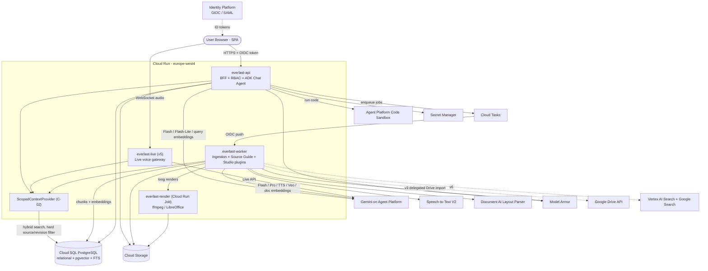

# Google Cloud solution architecture: Everlast LM

> **Status:** Accepted baseline (binding for technical choices per Constitution: Platform Constraints); open risks in §6. This covers Phase 1 (requirements and decomposition) and Phase 2 (solution design) of the `google-cloud-solution-build-deploy-agents` workflow.
> **Source of truth:** [`spec/System_Requirements_Specification_Gemeni_Notebook.md`](../spec/System_Requirements_Specification_Gemeni_Notebook.md)
> **GCP project:** `PROJECT_ID` (e.g. `everlast-lm-dev`)

### Decisions

*Taken 2026-10-15, revised 2026-10-17. IDs are stable; superseded decisions are marked, never renumbered.*

| # | Decision | Choice |
| :- | :- | :- |
| D1 | Retrieval | **pgvector + Postgres full-text search in the existing Cloud SQL instance** (hybrid search). We own chunking, chunk IDs and locators. *(Revised 2026-10-16: replaces RAG Engine, which needed an always-on Spanner instance and had no TypeScript SDK.)* |
| D2 | Backend language | **TypeScript end-to-end** (SPA and backend share one codebase) |
| D3 | Data residency | **EU preferred** (`europe-west4`, or `europe-west3`). Global endpoints are allowed for features not yet available in the EU |
| D4 | Operating model | **Lean serverless**: Cloud Run plus one Postgres, with as few managed extras as possible |
| D5 | FR-INT-01 (`@Notebook`) | Out of scope for now (SRS §5.5 DEV-03; Gate v6.0 #3 deferred). The design stays A2A-ready |
| D6 | Identity | No IdP chosen yet, so the design uses **generic OIDC/SAML** |
| D7 | FR-ST-03 Join-In voice | **Accepted deviation from the spec** (SRS §5.5 DEV-01): only one host (in that host's voice) answers live interruptions, then the podcast resumes. See §6 |
| D8 | FR-ST-16 Google Slides export | **Deferred** (SRS §5.5 DEV-02): v4 exports `.pptx` and `.pdf` only. Google Slides needs per-user OAuth |
| D9 | FR-ST-17 Infographics | **Deterministic structured-layout-to-SVG rendering only**, with PNG export. No image generation model, so text and numbers stay legible and traceable |
| D10 | FR-ST-04 link sharing | **Moved to v6.0.** v5.0 ships the player, background playback and `.mp3`/`.wav` download. Share links follow with notebook sharing, because their access rules depend on the FR-WM-05 roles *(2026-10-16)* |
| D11 | FR-SI-01 Google Docs/Slides import | v3 uses a minimal Google Drive adapter with delegated per-user read access and export to the existing Office normalization path. Alternatives: manual export (does not fulfill native linked import/re-sync), deferral to v6 (would remove assigned v3 scope). API enablement still needs owner approval; no specific corporate IdP is chosen. This does not reinstate Google Slides output export (D8). |
| D12 | NFR-PERF-01 large Studio contexts | Above model context capacity, map-reduce over **all original scoped chunks**, retaining chunk-level evidence; Source Guides help routing only. Summary-only reduction is rejected because it can discard required facts. No new datastore or framework. |
| D13 | FR-GC-02 validation and streaming | Buffer factual answers until complete citation validation, then publish. Status may stream while waiting but does not count toward TTFT. Immediate model-token streaming was rejected because invalid later citations would already have exposed an invalid answer. Apply the same rule before Live factual speech and Studio publication. |
| D14 | IaC toolchain | **OpenTofu (`tofu` >= 1.6) in `infra/`** in place of HashiCorp Terraform for MPL-2.0 open-source licensing and native `.tf` / GCS state compatibility *(2026-10-17)* |
| D15 | Canonical source text storage | **PostgreSQL `source_pages`** holds the canonical extracted text per page (the Source Inspector viewer representation), committed in the same transaction as chunks and the `Ready` transition, so notebook/source deletion removes it immediately with the relational cascade. Replaces the GCS viewer representation described in §4. Raw uploads stay in Cloud Storage. Alternative rejected: GCS JSON per revision (extra purge path, not atomic with publication) *(2026-10-19, project owner)* |
| D16 | Release v2 proof of concept | **Persistence update (2026-10-21, project owner, specs/013): v2 data is stored in PostgreSQL** (migrations `0005_v2_workspace`, `0006_v2_context`, `0007_notes`, `0008_studio_artifacts`) behind the existing repository functions, and survives restarts and redeploys; SRS §5.5 DEV-04 is closed. The API runs every request and its v2 background work in an app-scoped store selection bound to its pool; the in-memory stores remain only as test doubles. The in-process notebook mirror is gone: ownership, Ready counts and the notebook modified time come from the v1 tables. **Still in force:** one API instance; v2 background work (Source Guides, topic icons, Studio reports) runs in the API process. At start-up the API marks Studio reports left `Queued`/`Running` by a stopped process as `Failed` (`GenerationError`, Retry allowed; the only `Queued → Failed` path) and drops orphaned `GuidePending` guides so the next open regenerates them; a Ready source whose guide already exists in the effective language is not regenerated. During a Cloud Run revision rollout the old revision may still finish a report that the new one already marked interrupted; that report stays `Failed` and can be retried. History: *(2026-10-19)* **v2 data stayed in process memory until v3**, on purpose, so a running proof of concept was available earlier (SRS §5.5 DEV-04). Affected: workspace preferences, icons and pins (2.1); Source Guides, overviews, chat configuration, feedback and follow-ups (2.2); notes (2.3); Studio artifacts (2.4). **Exception (2026-10-20, project owner, specs/007 convergence):** sources made from notes (note-sources, `FR-NM-03/04`) are normal v1 PostgreSQL sources (`media_type: note_markdown`): the conversion reserves the slot with the v1 atomic reservation, so uploads and note-sources share one source limit, and the combined Markdown runs through the v1 Markdown ingestion (C-01 parser, chunker, embeddings) to `Ready`; origin notes with their revisions and the copied citations are stored as provenance (migration `0004_note_sources.sql`). The v1 chat, the Left Panel list and history projection therefore see note-sources like any upload, and they survive a restart (since specs/013 the notes do too). Access never depends on the in-memory stores: the API authenticates, checks notebook ownership in PostgreSQL before any v2 handler, and v2 reads source content only through `C-02` (PostgreSQL). Because v2 background work is in-process, it (Source Guides, topic icons, Studio reports) runs in the API process and the PoC runs **one API instance**; v2 data reset on restart or redeploy until specs/013. Source Guide, overview and follow-up generation use the Vertex AI Flash-Lite structured client (`europe-west4`, keyless ADC) whenever the Vertex model is configured and report 503 otherwise; Source Guides start from a bounded-interval Ready-transition watcher in the API process *(2026-10-20, specs/006 convergence)*; Studio reports use the Vertex AI Flash report model (`europe-west4`, keyless ADC, fixed grounding and citation instructions) whenever the Vertex model is configured and the deterministic, citation-checked extractor otherwise; dynamic report suggestions use the Flash-Lite structured client and are unavailable without it *(2026-10-20, specs/008 convergence)*; Studio jobs read every chunk of their snapshot in keyset pages (D12). The designed v2 tables waited in `packages/db/migrations/v3-draft/` until specs/013 turned them into migrations `0007`/`0008`. Note Assistant turns (`FR-NM-04`) are written to the v1 PostgreSQL chat thread, like any chat turn. Alternatives rejected: port v2 to PostgreSQL now (delays the PoC), revert v2 (discards finished work). *(2026-10-19, project owner)* |
| D17 | NFR-PERF-01 warm-service latency acceptance | **Accepted narrowing (SRS DEV-05):** the 2.5 s P95 target applies only to requests submitted after the service is awake. Measure/report wake-up delays separately without a release-blocking threshold. Both populations retain submission-to-first-validated-answer measurement (D13). Including wake-up requests in the same gate was considered and rejected by the owner; scale-to-zero remains unchanged. *(2026-10-19)* |
| D18 | FR-GC-08 managed sandbox resource envelope | **Owner-approved amendment (2026-10-20):** select Agent Platform's default **2 vCPU / 1.5 GB RAM** profile, replacing the former 1 vCPU / 512 MB caps and the initial Option A planning hold. Retain zero network, read-only scoped input, 64 MB temporary storage, 15.0 s execution and existing retries. The 4 vCPU / 4 GB profile is not approved. Retaining the old caps with an unqualified Pyodide fallback was considered; the owner instead chose the managed default. R6 remains an implementation/deployment qualification gate, not evidence already obtained. |

---

## 1. Executive summary and workload overview

Everlast LM is a company-internal workspace for source-grounded research, modelled on Gemini Notebook / NotebookLM. Users upload sources, chat with strictly grounded answers that carry clickable citations, and generate Studio artifacts (reports, mind maps, quizzes, podcasts and videos). The spec delivers this in six releases (v1.0 to v6.0).

**Proposed architecture in one paragraph:** A TypeScript monorepo deployed as a small set of **Cloud Run** services that scale to zero. **ADK for TypeScript (`@google/adk`)** is the only agent framework, used for the agentic parts: grounded chat, note assistant, and research agents. **`@google/genai`** handles media and real-time primitives (TTS, Live API, image and video generation). **Gemini on Gemini Enterprise Agent Platform** (formerly Vertex AI) is the model runtime, using EU regional endpoints. **Cloud SQL for PostgreSQL** is the single store for workspace data, chat history, notes, artifact metadata and learning progress. It is **also the retrieval index**: chunks, embeddings (`pgvector`, HNSW) and full-text vectors (`tsvector`) live in one `chunks` table. Retrieval is a hybrid search with a hard SQL filter on the selected `(source_id, revision)` pairs. **PostgreSQL `source_pages`** holds canonical viewer text (D15); **Cloud Storage** holds raw files, binary normalization intermediates and generated media. **Cloud Tasks** and **Cloud Run Jobs** run the asynchronous Studio and ingestion jobs. **Identity Platform** provides OIDC/SAML SSO.

---

## 2. Requirements and current state

### 2.1. Functional requirements (condensed; IDs refer to the SRS)

* **Workspace (`FR-WM-01..07`):** Notebook CRUD (title 1–100 Unicode code points after outer trim, cascade delete of DB/GCS/in-flight jobs), metadata (Unicode emoji grapheme cluster auto-assigned on first source ingest unless manually overridden, timestamps, `Ready` source counter), home overview with grid/list toggle, sorting (`recent` by per-user `last_opened_at`, `title_asc`, `created_desc`) and per-user pinning, strict per-notebook isolation (`FR-WM-04`), role-based sharing from v6.0 (`Owner`, `Editor`, `Viewer Full`, `Viewer Chat-Only`, optional 500-char welcome note; v1.0–v5.0 are strictly `Owner`-only), privacy-preserving daily usage analytics (`FR-WM-06`: UTC daily unique users and query counts over `7d`/`30d`/`90d` without exposing private chat transcripts), and atomic quotas (`FR-WM-07`: 50–300 sources per notebook, 100–500 notebooks per user, ≤ 500,000 extracted words and ≤ 200,000,000 bytes inclusive per source, plus v6 daily per-user UTC quotas for chat [500], audio [20] and video [20]).
* **Ingestion (`FR-SI-01..07`):** Subset A (v1.0): PDF (with OCR, layout and tables), TXT, MD, and pasted clipboard text (`"Pasted text"`, 1 char to 500,000 words). Subset B (v3.0): DOCX, PPTX, linked Google Docs/Slides via delegated per-user Drive read access (`D11`), web URLs (with SSRF and prompt-injection screening), video URLs (timestamped caption transcripts or audio ASR fallback), and audio files (`.mp3`, `.wav`, `.m4a` via ASR with `time_span` `mm:ss` locators). Also: automatic Source Guide (`FR-SI-02`: 100–250 word summary and 5–10 topic chips ≤ 40 chars via singleton `C-02` scope), explicit per-request source selection (`FR-SI-03`: $S_{\text{aktiv}}$, session-local per user/notebook, never falling back server-side to all sources when empty except for `Viewer Chat-Only` in v6.0), in-app Source Inspector (`FR-SI-04`: virtualized scrolling with `[data-chunk-id]` anchors and media player), source rename (1–200 chars), delete and atomic staged re-sync (`FR-SI-05`), and the v6.0 Discover Sources (`FR-SI-06`: up to 10 ACL-filtered intranet/web hits with `"I'm feeling curious"` topic confirmation) and Deep Research (`FR-SI-07`: user-approved research plan, 2–5 hops, up to 25 primary sources + cited report artifact and source) agents.
* **Grounded chat (`FR-GC-01..09`):** Answers strictly from $S_{\text{aktiv}}$ and eligible history turns (excluding any prior turn whose snapshot includes a deselected, replaced, or unauthorized source/revision). Every factual statement gets sequential `[1..K]` inline citations (`FR-GC-02`, collapsing $>3$ badges per sentence into `+N`) validated before publication (`D13`), with verbatim hover snippet (in original source language) and click-to-scroll highlighting (`FR-GC-03`; click-through blocked for `Viewer Chat-Only` and marked `"Source deleted"` or `"Source updated"` on deleted/re-synced sources). Also: notebook overview + 3–5 starter prompts (`FR-GC-04`, cached per scope/revision/auth/language key), 0–3 follow-up chips (`FR-GC-05`), persistent per-user conversation history with in-thread search and stream-aborting clear (`FR-GC-06`), per-user personas (`default`, `learning_guide`, `analyst`, `custom` 1–5,000 code points) and response lengths (`FR-GC-07`), isolated Python code sandbox (`FR-GC-08`: 2 vCPU, 1.5 GB RAM, 64 MB `/tmp`, 15 s timeout, max 1 exception retry, `Computed` badge, chart PNG/SVG and collapsible code block), and response actions (`FR-GC-09`: copy with/without citations, idempotent save-to-note, thumbs up/down with structured error categories).
* **Notes (`FR-NM-01..04`):** Rich-text/Markdown notes (title 1–200 chars, body 0–100,000 words) with debounced auto-save and local draft recovery (`FR-NM-01`), saving chat responses as read-only notes with preserved citations (surviving chat clear; `"Convert to editable note"` creates a manual copy with citation badges stripped so edits cannot masquerade as verified claims, `FR-NM-02`), 1-click conversion of single, selected, or all notes into a single bounded `Ready` source (`FR-NM-03`, preserving original notes and reserving 1 quota slot), and contextual AI actions (`Summarize`, `Create outline`, `Suggest related ideas`, `Critique`) on 1–50 selected notes (`FR-NM-04`, converting the selection into a `Ready` note-source first and outputting a citation-validated `ChatMessage`).
* **Studio (`FR-ST-01..18`):** All generators run via `C-03` (`Queued → Running → Completed | Failed | Cancelled`). Audio Overviews: 2-host dialogue with persisted timestamped transcript and diarization/clipping validation (`FR-ST-01`), pre-generation customization (`FR-ST-02`: `shorter` 3–5 min / `default` 8–12 min / `longer` 15–20 min, ≥ 35 languages, 0–2,000 char focus prompt), live `"Join-In"` voice interrupt at exact `t_interrupt_ms` with single designated host reply validated before speech (`FR-ST-03`, `D7`/`DEV-01`), and persistent mini-player with $0.5\times\text{–}2.0\times$ pitch-preserved speed, `.mp3` (192 kbps) / `.wav` (24 kHz PCM) export and v6.0 authenticated deep-links (`FR-ST-04`, `D10`). Video Overviews: Narrated Slideshow (`FR-ST-05`), Short Video 45–75 s in `16:9` or `9:16` (`FR-ST-06`), and Cinematic Video 1080p@30fps in 4 visual styles with sharp vector overlays and no silent slideshow fallback (`FR-ST-07`), all producing both H.264/AAC `.mp4` and VP9/Opus `.webm` with `<100 ms` A/V drift and `.vtt` subtitles. Mindmaps: acyclic tree JSON (depth 2–5, 15–120 nodes, `FR-ST-08`) with pan/zoom, expand/collapse, scope-checked chat drilldown and `.png`/`.svg` export (`FR-ST-09`). Reports: 4 standard templates (`briefing_doc`, `study_guide`, `faq`, `timeline`, `FR-ST-10`), 3–4 dynamic suggested formats + custom reports (`FR-ST-11`), and composite Interactive Learning Overviews (3–6 modules combining summaries, SVG diagrams, flashcards and checkpoint quizzes; fails atomically if any block fails, `FR-ST-12`). Active Learning: Flashcards (`easy`/`medium`/`hard`, 10/20/35 cards, 3D flip and chat `"Explain"`, `FR-ST-13`), Quizzes (5–25 questions across MC, Multiple Select, Fill-in-the-blank, Short Answer with rubric-guarded semantic grading and hints, `FR-ST-14`), and server-side per-user `LearningProgress` with `"Review missed"` (`FR-ST-15`). Visuals & Tables: Slide Decks (5–20 slides, ≤ 5 bullets × ≤ 15 words, speaker notes, `.pptx`/`.pdf` export, `FR-ST-16`, `D8`/`DEV-02`), deterministic SVG/PNG Infographics in 5 layout styles (`FR-ST-17`, `D9`), and Data Tables (2–25 cols, 1–500 rows, cell citations or `"N/A (Not in sources)"`, formula-sanitized RFC 4180 `.csv` with UTF-8 BOM and `.xlsx` export, `FR-ST-18`).
* **Ecosystem/UI (`FR-INT-01`, `FR-UI-01/02`):** `@Notebook` from the enterprise chat (deferred, `D5`/`DEV-03`), adaptive 3-column SPA (`FR-UI-01`: desktop $\ge 1280\text{ px}$ 3 columns open, laptop $1024\text{–}1279\text{ px}$ right panel collapsed by default, $<1024\text{ px}$ tabbed, panel state in `localStorage`), and theme (`light`/`dark`/`system`) plus BCP-47 input (`auto` default) and output language hierarchy (`FR-UI-02`: explicit job language > personal notebook override > notebook default > user default > browser locale > `en-US`).

### 2.2. Non-functional requirements

* **Security:** Enterprise endpoints with contractual no-training guarantee (`NFR-SEC-01`, distinguishing contractual no-training from zero-data-retention unless explicitly verified). SSO via OIDC/SAML with full signature/issuer/audience/expiry validation, plus upstream document ACL provenance preserved across search, retrieval, re-sync, citation previews, exports and Studio artifacts (`NFR-SEC-02`). Server-side RBAC on every API and worker (Owner-only in v1.0–v5.0; full role matrix in v6.0 so a `Viewer Chat-Only` user receives `403` on `/sources`, `/chunks`, `/notes`, and `/studio` and can access only an answer-bound citation preview endpoint for chunks cited in their own answers, Gate v6.0 #1).
* **Quality gates:** Hallucination rate $< 5\%$ (`NFR-EVAL-01`). Deterministic citation ID precision $= 1.0$ plus LLM-judged semantic citation entailment (`NFR-EVAL-02`). Negative rejection $\ge 99\%$ on out-of-source world-knowledge queries (`NFR-EVAL-03`). Context leakage from deselected, deleted, or unauthorized sources $= 0$ across retrieval, history carry-over, caches, and drilldowns (`NFR-EVAL-04`).
* **Performance:** Effective active context of $\ge 1 \times 10^6$ tokens (excluding deselected decoys) with warm-service standard chat TTFT $\le 2.5\text{ s}$ P95 (`NFR-PERF-01`, measured from submission to first validated answer token, excluding progress events per `D13`; non-gating target in v1.0, gating in Gate v3.0 #3). D17/DEV-05 excludes requests waiting for wake-up from this acceptance population; measure/report wake-up delays separately without a release-blocking threshold. Source Guide $< 10\text{ s}$ P95 after `Ready` (Gate v2.0 #1). Voice-to-Voice Join-In latency $\le 2.5\text{ s}$ P95 (Gate v5.0 #2).
* **Cost:** Close to zero at idle (`D4`). This is a showcase project with no production SLA.
* **Reliability:** Single region (`europe-west4`), with Cloud Run's built-in multi-zone serving. No formal RTO/RPO yet.
* **Operations:** Spec-driven, test-first development with automated release gates (SRS §5.4). Deterministic eval suites (`NFR-EVAL-02`, `NFR-EVAL-04`) run on every PR; LLM-judged suites (`NFR-EVAL-01`, `NFR-EVAL-03`, semantic citation support) run once per release gate on a fixed stratified 50-case sample of the golden dataset (Constitution v2.0.0).
* **Sustainability:** Scale to zero, and route work to the smallest model that meets the quality bar.

### 2.3. Current state

Greenfield. The repo holds the SRS, FR cards, constitution and this architecture; no application code or generated feature specs exist yet. The target GCP project must have these relevant APIs enabled: `run`, `cloudbuild`, `artifactregistry`, `pubsub`, `storage`, `cloudtrace`, `logging`, `monitoring`, `datastore`.
**Not yet enabled (required, see §7):** `aiplatform`, `sqladmin`, `cloudtasks`, `secretmanager`, `identitytoolkit`, `speech`, plus `documentai`, `modelarmor` and `discoveryengine` depending on release.

### 2.4. Dependencies

* **Internal:** The corporate IdP (not yet chosen) and, from v6, the intranet search index and its ACL source.
* **External:** Public web and YouTube for URL and video ingestion. Google Search for Discover Sources.

---

## 3. Technical decomposition of the workload

### 3.1. Agent design pattern: hybrid multi-agent system

The spec (§4.1) describes everything as a multi-agent system. Most of the "agents" in it, however, are **deterministic pipelines**: the steps are known in advance and the LLM is just one step. Building those as autonomous agents adds latency, cost and non-determinism, and makes the spec gates harder to pass. Recommendation:

| Kind | Components | ADK construct |
| :- | :- | :- |
| **Agentic** (the LLM chooses tools and steps) | Grounded Reasoning & Citation Agent; Code Execution (as a tool of the chat agent); Discovery & Deep Research Agent; Note Assistant (`FR-NM-04`, preceded by disclosed `FR-NM-03` note-to-source snapshot conversion) | `LlmAgent` with tools; `LoopAgent`/`ParallelAgent` for research |
| **Deterministic workflow** (code-orchestrated, LLM calls as steps) | Ingestion & indexing; Source Guide (`FR-SI-02`); Notebook Overview & Starter Prompts (`FR-GC-04`); Follow-up Chips (`FR-GC-05`); all Studio generators (reports, dynamic report suggestions, learning overviews, mind maps, tables, flashcards, quizzes + semantic grading, slides, infographics); audio and video rendering | Plain TS job handlers calling `@google/genai` with structured output, or ADK `SequentialAgent` with `outputSchema` where tracing or evals help |

### 3.2. Logical components

| ID | Component | Responsibility | Spec contract |
| :- | :- | :- | :- |
| C1 | **SPA** | Adaptive 3-column UI (`FR-UI-01`), theme & BCP-47 language controls (`FR-UI-02`), virtualized Source Inspector (`pdf.js`, `[data-chunk-id]` DOM anchors, media player; `FR-SI-04`), citation hover and scroll (`FR-GC-03`), persistent mini-audio player (`FR-ST-04`) | FR-UI-01/02, FR-SI-03/04, FR-GC-03, FR-ST-04 |
| C2 | **API / BFF** | AuthN (OIDC/SAML token validation), server-side RBAC middleware (`Owner`-only in v1–v5, full role matrix in v6), atomic quota reservation (`FR-WM-07`), CRUD, SSE chat progress & validated answer delivery (`D13`), answer-bound citation preview endpoint (`FR-WM-05`), job triggering | FR-WM-01..07, Gate v6 |
| C3 | **ScopedContextProvider** | The **only** path to source content: `getScopedContext(notebook_id, active_source_ids)` with submission-time `(source_id, revision)` snapshots, upstream ACL verification, and singleton inspector/guide read scopes | **C-02**, NFR-EVAL-04, NFR-SEC-02 |
| C4 | **Ingestion pipeline** | Format adapters normalizing every source to `UnifiedDocumentChunk` (`page_span`, `time_span`, `dom_path`), SSRF & Model Armor screening, atomic staged re-sync, plus the asynchronous Source Guide worker | **C-01**, FR-SI-01..05 |
| C5 | **Grounded chat agent** | Hybrid retrieval + Source Guide routing (`NFR-PERF-01`), history turn filtering (`NFR-EVAL-04`), pre-publication citation validation (`D13`), notebook overview & starter prompts (`FR-GC-04`), follow-up chips (`FR-GC-05`), personas (`FR-GC-07`), feedback & save-to-note (`FR-GC-09`), note assistant (`FR-NM-04`) | FR-GC-01..09, FR-NM-01..04 |
| C6 | **Code sandbox** | Network-isolated Python execution (`2 vCPU`, `1.5 GB RAM`, `64 MB /tmp`, `15 s` timeout, max 1 exception retry) on scoped source data, returning `Computed`-labelled values, PNG/SVG plots, and collapsible code trace | FR-GC-08, Gate v3 |
| C7 | **Studio job runner and plugin registry** | `StudioGeneratorPlugin.triggerJob()`, the `StudioArtifact` table, unified `Queued → Running → Completed | Failed | Cancelled` lifecycle, and `LearningProgress` state (`FR-ST-15`) | **C-03**, FR-ST-01..18 |
| C8 | **Media renderers** | `ffmpeg` (2-host audio stitching, waveform/diarization verification, H.264/AAC `.mp4` and VP9/Opus `.webm` video muxing with `<100 ms` A/V drift and `.vtt` subtitles), LibreOffice (`.docx`/`.pptx` to PDF normalization and `.pptx` to `.pdf` slide export) | FR-SI-01, FR-ST-01, 04..07, 16 |
| C9 | **Live voice gateway** | WebSocket bridge between browser and Gemini Live (`everlast-live`), pausing podcast at exact `t_interrupt_ms`, executing grounded tool calls through C3, validating citation IDs before speech synthesis (`D13`), and replying in the single designated host's voice (`D7`/`DEV-01`) | FR-ST-03, Gate v5 |
| C10 | **Research agents** | Discover Sources (`FR-SI-06`: up to 10 ACL-filtered intranet/web candidates) and Deep Research (`FR-SI-07`: user-approved research plan, 2–5 hops, primary source import before report synthesis); all imports flow through C4 | FR-SI-06/07, NFR-SEC-02, Gate v6 |
| C11 | **Eval harness** | Automated deterministic (`NFR-EVAL-02`, `NFR-EVAL-04`) and LLM-judged (`NFR-EVAL-01`, `NFR-EVAL-03`, semantic citation support) Vitest suites as CI and release gates | §4.2, §5.4 |
| C12 | **Data stores** | Relational data, vectors (`pgvector`) and full-text search (`tsvector`) in one Cloud SQL Postgres; canonical viewer text in PostgreSQL `source_pages` (D15); raw uploads, binary normalization intermediates and generated media in GCS | D1, D4 |
| C13 | **Identity** | OIDC/SAML federation (`Identity Platform`), user/group principal extraction, and delegated OBO/OAuth tokens for enterprise repository access | D6, D11, NFR-SEC-02 |

### 3.3. Deployable units (kept deliberately small)

| Service | Type | Contains |
| :- | :- | :- |
| `everlast-api` | Cloud Run service | C2, C3, C5 (ADK chat agent, overview/starter prompts, follow-ups, quiz Short Answer grading), note operations (`FR-NM-01..04`). Also serves the SPA build (C1) as static assets. |
| `everlast-worker` | Cloud Run service (Cloud Tasks target, internal ingress) | C4 ingestion and Source Guide, C7 Studio plugins (reports, mind maps, data tables, flashcards, quizzes, slides, infographics, learning overviews, audio/video orchestration), C10 research jobs |
| `everlast-render` | Cloud Run **Job** | C8: `ffmpeg` (audio/video assembly, MP4+WebM encoding), LibreOffice (DOCX/PPTX normalization and Slide Deck PDF export) |
| `everlast-live` *(v5)* | Cloud Run service (WebSockets, session affinity) | C9 (`FR-ST-03` interactive Join-In voice gateway) |

A **pnpm monorepo** holds the shared `packages/contracts`, which defines C-01, C-02 and C-03 as **Zod schemas**. The SPA, the API, the workers and the ADK tool definitions all import the same types. This is the main benefit of choosing TypeScript (D2), because the architectural contracts are enforced at compile time.

---

## 4. Proposed solution architecture

### 4.1. Google Cloud products and features mapping

| Component | Recommended | Justification | Alternatives considered | Pros / cons of alternatives |
| :- | :- | :- | :- | :- |
| **Agent framework** | **ADK for TypeScript** (`@google/adk`) | The skill's product mapping names ADK as the primary agent framework. ADK TS has Zod-typed tools, `Sequential/Parallel/LoopAgent`, A2A support (keeps FR-INT-01 open), a dev UI, and Cloud Run deployment. Details in §4.2. | Genkit (JS); ADK Python; plain `@google/genai` | See §4.2 |
| **Model runtime** | **Gemini on Gemini Enterprise Agent Platform**, regional EU endpoint | Enterprise data governance (contractual no-training on customer data, covering `NFR-SEC-01`; documentation distinguishes contractual no-training from zero-data-retention unless verified), IAM auth with no API keys, and regional processing (D3) | Gemini Developer API (AI Studio) | **Pro:** fastest access to new features. **Con:** not the enterprise data-governance path, and weaker residency controls. **Do not use it for company data.** |
| **Model routing** | **Flash** for chat and Studio; **Flash-Lite** for Source Guide, notebook overview & starter prompts (`FR-GC-04`), dynamic report suggestions (`FR-ST-11`), follow-up chips (`FR-GC-05`), topic emoji selection (`FR-WM-02`), quiz Short Answer semantic grading (`FR-ST-14`) and eval judges; **Pro** for deep research (`FR-SI-07`), podcast scripts (`FR-ST-01`) and long reports *(owner default 2026-10-20: v2 Studio reports use Flash only until "long report" is defined, specs/008)* | The skill recommends Flash as the text default. TTFT ≤ 2.5 s rules out Pro for interactive chat. Starting with the smallest model saves cost and energy. | Pro everywhere | **Pro:** better reasoning. **Con:** latency, cost, and would miss the TTFT target |
| **Retrieval / vector store** | **pgvector + Postgres full-text search in Cloud SQL** (D1): one `chunks` table (`notebook_id`, `source_id`, `revision_id`, `chunk_id`, `text`, `token_count`, `locator jsonb`, `embedding vector`, `tsv tsvector`). HNSW index with **pgvector 0.8 iterative scans** (`hnsw.iterative_scan`). Hybrid ranking = vector top-N ∪ full-text top-N, merged with Reciprocal Rank Fusion in SQL. | The source-content projection of the `chunks` table implements C-01 (`source_id`, `chunk_id`, `text`, `token_count`, `locator`), so chunk IDs and polymorphic locators (`page_span`, `time_span`, `dom_path`) are ours. `NFR-EVAL-04` becomes a hard `WHERE notebook_id = $1 AND (source_id, revision_id) IN (...)` in one function (C-02). Iterative scans stop restrictive filters from returning too few rows. Hybrid search covers exact terms (names, IDs, numbers) that embeddings miss. No extra fixed cost, because it is the same instance. | RAG Engine (previous choice); AlloyDB (ScaNN, hybrid search); Vertex AI Search | **RAG Engine:** managed parsing, but an always-on Spanner instance, no TS SDK and limited control over locators. **AlloyDB:** stronger vector performance and in-database AI, but a much higher base cost. The catalog's `google-cloud-solution-hybrid-search-alloydb` skill is the upgrade path. **Vertex AI Search:** managed, but opaque chunking and no hard per-source filter |
| **Embeddings** | **Gemini embedding model on Agent Platform** (EU endpoint), `taskType` `RETRIEVAL_DOCUMENT` / `RETRIEVAL_QUERY`; reduced output dimension (e.g. 768) to keep the HNSW index small | Same governance as the LLM calls. A smaller dimension keeps index RAM within a small Cloud SQL tier. | `text-embedding-005`; open model on Cloud Run | **Open model:** no per-call cost, but GPU hosting and ops. Pin the model version in `chunks.embedding_model` so re-embedding is a planned job, not a surprise |
| **Reranking (optional)** | Skip in v1. Add the **Vertex AI ranking API** only if EVAL-01/02 benchmarks show retrieval misses | Keeps v1 lean; RRF is usually enough | Flash-Lite as a reranker | **Pro:** no new API. **Con:** adds latency against the 2.5 s TTFT target |
| **Long-context path** | Gemini **context caching** for async Studio jobs | Studio synthesis such as reports, mind maps or podcasts improves with full-text context, and it is latency-insensitive. Use the full normalized text when it fits in `1,000,000` tokens. Otherwise map-reduce over all original scoped chunks in bounded batches with retained chunk-level evidence (D12); Source Guides assist routing/planning (`FR-ST-08`, `NFR-PERF-01`), never replace source text. | Long context in chat as well | **Con:** TTFT with very large prompts would break the 2.5 s target, so chat stays RAG-first (combining `Source Guide` summaries with hybrid chunk retrieval for broad synthesis queries) |
| **PDF / Office parsing and chunking** | **Own chunker** in `everlast-worker` (structure-aware, target 300–600 tokens per chunk (`FR-SI-01` chunker policy, not a C-01 size invariant) with overlap, never across page or section boundaries). Text PDFs: `pdfjs-dist` text with page numbers. **Scanned or tabular PDFs: Document AI Layout Parser** (OCR, tables, page-anchored blocks). DOCX/PPTX: convert to PDF with LibreOffice in `everlast-render`, then use the PDF path plus supplemental extraction of speaker notes and visual descriptions into the normalized viewer, so `page_span` locators cover all required content (slide numbers are page metadata, not a separate locator variant). Google Docs/Slides use delegated per-user Drive export (D11) and retain external doc ID for re-sync | Every adapter emits the same `UnifiedDocumentChunk` (`page_span` with optional physical page for TXT/MD/Copied Text/Note Markdown), and the Source Inspector can highlight any document format | Gemini document understanding as the parser | **Pro:** handles messy layouts well. **Con:** page anchors are generated by the model and less deterministic. Usable as a fallback for files Document AI cannot parse |
| **ASR (audio)** | **Cloud Speech-to-Text V2 (Chirp)** batch with word time offsets | `time_span` locators (`{ start_ms, end_ms, display_time: "mm:ss" }`) must be exact (Gate v3.0 #1: clickable `mm:ss`, ≤ 45 s P95 for 30-min audio) | Gemini audio transcription | **Pro:** cheaper and one less API. **Con:** timestamps are generated by the model and less precise |
| **Video URLs** | YouTube and enterprise media captions where available; otherwise extract the audio track and send it through Speech-to-Text V2 (fails with `"No transcript available for this video"` if neither exists) | Same `time_span` locator guarantee | Gemini video understanding of YouTube URLs | Good as a fallback for videos without captions |
| **Web ingestion** | Fetch (with pre-connect/redirect SSRF blocking of loopback, link-local, metadata, IPv4-mapped IPv6, and unapproved private/ULA ranges; PDF content-type auto-routes to PDF parser) plus Mozilla Readability in `everlast-worker` | Main-content extraction; each chunk stores a `dom_path` locator and canonical URL | Gemini URL-context tool | **Con:** no deterministic DOM locators |
| **Relational DB** | **Cloud SQL for PostgreSQL 16+** (Enterprise edition, IAM DB auth, `vector` extension). Start on the smallest **dedicated-core** tier once vectors exist (v1); shared-core tiers are short of RAM for HNSW | "One Postgres" (D4). Holds notebooks, user notebook preferences (`is_pinned`, `last_opened_at`, `chat_config`, `input_language`, `output_language`; grid/list view and sort order stay in the browser's `localStorage`, FR-WM-03), sources & revisions, upstream document ACL provenance, `NotebookACL`, atomic quota counters & `TenantQuotaPolicy`, chunks & embeddings, chat threads/messages & feedback, notes, `StudioArtifact`, `LearningProgress`, and privacy-preserving `NotebookDailyMetrics`. | Firestore; AlloyDB | **Firestore:** truly scales to zero, but no hybrid search and clumsier relational RBAC joins. **AlloyDB:** see the retrieval row |
| **Chat sessions / history** | **Own Postgres tables** (`ChatThread`, `ChatMessage`) plus a custom ADK `SessionService` backed by them | `FR-GC-06` needs single-thread-per-user-per-notebook persistence, in-thread full-text search with jump-to-message, stream-aborting clear/reset, and per-turn `active_source_ids_snapshot` (including revisions) so turns referencing deselected/revoked sources are excluded from future prompts (`FR-GC-01`, `NFR-EVAL-04`). | **Agent Platform Sessions** (the skill's primary choice) | **Pro:** managed, low-ops. **Con:** needs an Agent Runtime instance, history search is not built for our UI, and it adds a second state store |
| **Object storage** | **Cloud Storage** (one bucket per environment, uniform access, signed URLs) | Raw uploads (size-constrained to ≤ 200,000,000 bytes), binary normalized PDFs (canonical viewer text is PostgreSQL `source_pages`, D15), sandbox chart artifacts, and generated Studio media (`.mp3`, `.wav`, `.mp4`, `.webm`, `.vtt`, `.pptx`, `.pdf`, `.svg`, `.png`, `.csv`, `.xlsx`) | — | — |
| **Async jobs (C-03)** | **Cloud Tasks** pointed at `everlast-worker`, plus **Cloud Run Jobs** (`everlast-render`) for long renders | Per-job retries, rate limiting (protects model quota), cancellation support, and deduplication. Scales to zero. | Pub/Sub (already enabled); Workflows | **Pub/Sub:** fan-out, but weaker per-job control. **Workflows:** good for many-step media pipelines and could be added in v5 |
| **Code sandbox** | **Agent Platform code execution sandbox** (gVisor, stateful files), called over REST from TS (`2 vCPU`, `1.5 GB RAM`, `64 MB /tmp`, `15.0 s` wall-clock timeout, zero network egress, pre-installed `math`, `statistics`, `numpy`, `pandas`, `matplotlib`, `scipy`; max 1 self-correction retry on exception, 0 retries on timeout/OOM) | The skill names it as Agent Runtime's secure code execution sandbox. Streams `"Running code…"` status within ≤ 2.5 s and labels numerical outputs `Computed` (`FR-GC-08`). | Gemini built-in code execution tool; Pyodide (WASM) in Cloud Run with no egress | **Built-in tool:** simplest, but less control over file I/O. **Pyodide:** what the spec suggests and fully ours, but we would have to harden it ourselves. ⚠️ **R6** |
| **Audio Overview (TTS)** | **Gemini multi-speaker TTS** (two voices: `Host_A` & `Host_B`, ≥ 35 languages, `shorter` 3–5m / `default` 8–12m / `longer` 15–20m) on Agent Platform; `ffmpeg` stitching, waveform/diarization check (0 clipping, no silent dropouts > 2s), and `.mp3` (192 kbps) + `.wav` (24 kHz PCM) export in `everlast-render` | Natural two-host dialogue from a single grounded script, persisted with a timestamped turn-by-turn cited transcript (`FR-ST-01`, `FR-ST-02`, `FR-ST-04`) | Cloud Text-to-Speech | **Con:** less natural turn-taking between hosts |
| **Join-In (live voice)** | **Gemini Live API** (native audio, 16/24 kHz PCM/Opus) through `everlast-live` (WebSocket) | Pauses podcast immediately at `t_interrupt_ms`, handles 6s silence timeout, executes grounding tools on the server against C3 (`C-02`), validates citation IDs before playing factual speech (`D13`), and replies in the designated host's voice in ≤ 2.5 s P95 (`FR-ST-03`, `D7`/`DEV-01`). | Browser connecting to Live directly with ephemeral tokens | **Con:** grounding tools would run on the client, which breaks C-02. Voice handling follows the accepted deviation **D7**; see also **R5** |
| **Infographics & Mindmaps** | **Deterministic SVG** rendered from a Gemini structured layout (`auto`, `process_flow`, `comparison`, `metrics_summary`, `architecture_diagram` for `FR-ST-17`; acyclic rooted tree depth 2–5, 15–120 nodes for `FR-ST-08/09`), with `2x` retina `.png` and lossless `.svg` export (D9) | Numbers and labels in graphics stay 100% legible, wrap without clipping, and remain traceable to source chunks | Gemini image generation for illustrative visuals; image model only | **Con:** risk of hallucinated figures and garbled text; extra API and cost |
| **Slides & Data Tables** | **Slides (`FR-ST-16`):** Gemini structured outline (5–20 slides, 5 layouts, ≤ 5 bullets × ≤ 15 words + speaker notes), rendered with `pptxgenjs` (`.pptx`) and LibreOffice in `everlast-render` (`.pdf`). **Data Tables (`FR-ST-18`):** 2–25 cols × 1–500 rows with cell citations or `"N/A (Not in sources)"`, exported as formula-sanitized (`=`, `+`, `-`, `@` escaped) RFC 4180 `.csv` (UTF-8 with BOM) and `.xlsx` | Gate v3.0 #3 requires valid CSV/XLSX; Gate v4.0 #3 requires PPTX and PDF files that open without errors | Google Slides API | Needs per-user OAuth; deferred (D8) |
| **Active Learning (`v4.0`)** | **Flashcards (`FR-ST-13`):** 10/20/35 cards (`easy`/`medium`/`hard`). **Quizzes (`FR-ST-14`):** 5–25 questions (MC, Multiple Select, Fill-in-the-blank, Short Answer with rubric-guarded Flash-Lite semantic grading ≤ 1.5 s). **Learning Overviews (`FR-ST-12`):** composite 3–6 modules combining summaries, SVG diagrams, flashcards, and checkpoint quizzes (fails atomically if any required block fails). **Progress (`FR-ST-15`):** per-user `LearningProgress` in Postgres | Strict `C-02` grounding (`Gate v4.0 #1`) and 100% cross-session persistence of `needs_review` items (`Gate v4.0 #2`) | Client-only progress storage | **Con:** loses state across devices and shared notebooks |
| **Video overviews (`v5.0`)** | **Narrated slideshow (`FR-ST-05`):** `FR-ST-16` slides + TTS + `ffmpeg` + `.vtt` chapters. **Short video (`FR-ST-06`):** 45–75 s (`16:9` or `9:16`), auto-trimmed to ≤ 160 words before TTS. **Cinematic (`FR-ST-07`):** 1080p@30fps in 4 styles (`scientific`, `professional`, `editorial`, `sketch_note`) via **Veo / Gemini Omni Flash** on global endpoint + sharp vector data overlays (no silent fallback to slideshow on failure). All 3 modes output both H.264/AAC `.mp4` and VP9/Opus `.webm` (`<100 ms` drift, Gate v5.0 #3) | Narrated slideshows reuse v4 and v5 components cheaply; dual MP4/WebM encoding guarantees cross-browser playback | Generative video for all three | **Con:** cost, render time, and garbled text without vector overlays |
| **Safety** | **Model Armor** (pay per use) on chat input and on **ingested web, synced, and research content** (quarantined content never transitions to `Ready` or enters `C-02`) | The skill says always include it. Indirect prompt injection from scraped pages is the main threat to strict grounding (Constitution VI). | None | Not recommended |
| **Identity (SSO)** | **Identity Platform** with OIDC/SAML providers (D6); the API validates JWT signature, issuer, audience, and expiry (or SAML Conditions/recipient/InResponseTo) and extracts `user_id`, `email`, and `groups` (`NFR-SEC-02`) | Works with any IdP chosen later and gives app-level identity and group principals for RBAC and intranet ACL filtering | IAP | **Pro:** zero app code. **Con:** coarse access only, so app RBAC still needs identity. The classic setup also requires a load balancer (fixed cost). |
| **Secrets** | **Secret Manager**, mounted into Cloud Run | The skill requires encrypted storage for credentials | Plain environment variables | Not recommended |
| **Hosting / networking** | **Cloud Run**, `europe-west4`, scale to zero, direct HTTPS ingress; the worker uses internal ingress with OIDC-authenticated Cloud Tasks | Lean (D4) | Regional external load balancer plus Cloud Armor (the skill's primary choice) | **Pro:** WAF and rate limiting. **Con:** fixed monthly cost. **Add in v6** for the enterprise rollout. |
| **Observability** | Cloud Logging (structured JSON) and Cloud Trace (OpenTelemetry) | Agent reasoning traces; both APIs are already enabled | — | — |
| **Evaluation** | Spec gates as **Vitest suites** (deterministic `NFR-EVAL-02/04` on every PR; LLM-judged `NFR-EVAL-01/03` + semantic citation support with Flash-Lite once per release gate on a fixed stratified 50-case sample); Agent Platform **Gen AI evaluation** for benchmark runs | EVAL-01..04 must be automated release gates against the versioned golden JSONL dataset (≥ 100 negative rejection, ≥ 50 deselected-source/history, ≥ 50 multi-doc synthesis cases) | ADK or agents-cli eval | Python-centric. Check TS support (**R3**) |
| **Discover Sources (v6)** | ADK agent with **Grounding with Google Search** (web) and **Vertex AI Search** connectors (intranet, ACL-aware via OBO token or `user_principals INTERSECT document_acl != EMPTY`, `FR-SI-06`) | Curates up to 10 hits in ≤ 8 s P95; `"I'm feeling curious"` shows a suggested topic for confirmation before submitting. ACL enforcement is delegated to the index (`NFR-SEC-02`, Gate v6.0 #2) | Own crawler | **Con:** ACL sync is very hard to build yourself |
| **Deep Research (v6)** | ADK `LoopAgent` (or managed **Interactions API background execution** if available in EU): generates a **Research Plan** in ≤ 5 s for explicit user approval, reserves ≥ 2 source slots (≥ 1 primary + 1 report), runs 2–5 search hops (≤ 180 s, progress every ≤ 3 s), imports up to 25 primary sources through `C-01` to `Ready`, then synthesizes the cited report via `C-02` and `C-03` and ingests it as a `Ready` source (`FR-SI-07`) | Enforces primary-source-first grounding, OBO token refresh (aborting intranet branch on auth expiry without service-account fallback), and clean cancellation | — | Check availability and EU processing at v6 time |
| **@Notebook (deferred)** | Later: expose the chat agent over **A2A** from ADK; if the target is Gemini Enterprise, publish it there | No v1–v6 work (`D5`/`DEV-03`), just keep the agent stateless and behind C3 | — | — |

### 4.1.1. Package 3.1 ingestion implementation refinements (FR-SI-01/05, C-01)

Under D3/D11, use Speech V2 Chirp 2 word offsets in `europe-west4`, verifying project/language availability before deployment; no silent fallback to a non-approved region. The 30-minute audio P95 target remains 45 seconds including queue wait, measured through complete timestamped transcript availability. Use existing LibreOffice/PDF normalization plus supplemental notes/visual descriptions with deterministic page anchors. Model Armor screening fails closed; its regional template is configured in `europe-west4` with EU jurisdiction controls.

Delegated Drive export must distinguish provider capability/size failures from the application quota, use supported long-running download/export when appropriate, and never truncate or substitute privileged credentials. Public YouTube visibility does not establish permission to download captions or audio; inaccessible media follows the existing explicit error. These choices do not defer assigned v3 scope. Provider references and deployment risks are recorded in [package 3.1 research](../specs/009-multimodal-ingestion-sync/research.md).

Persist a single-active-operation fence and staged revision for re-sync; delivery retries resume the same operation while distinct overlapping requests are rejected without a follow-up queue. Reuse the existing `jobs` outbox, `publishReadySource`, and C-02 PostgreSQL adapter; add a sync-specific Ready-preserving fenced publication path rather than force the existing Processing-only guard to admit Ready sources. Commit canonical `source_pages` text, chunks/revision/hash and publication events atomically after complete validation and access checks (D15). Guide storage is already durable under D16/specs/013 (0006); reuse it and app-scoped pool selection. Package 3.1 adds durable re-sync publication/Guide events and transaction-aware active-revision/attempt fences behind existing repositories. The API watcher and on-open orphan recovery are not durable dispatch; recovery after sync must not depend on user reopening or a bounded watcher lookback. Preserve existing Ready guides and the current one-API deployment until dispatcher changes are qualified. Source media is served through authorization-checked delivery; a reusable signed Storage URL alone cannot satisfy immediate deletion/revocation invalidation. C-01 consumers remain on shared schemas; display `mm:ss` is derived viewer metadata, not a new locator field or variant.

### 4.2. ADK vs. Genkit for a TypeScript backend

| Criterion | ADK for TypeScript | Genkit (JS) |
| :- | :- | :- |
| Primary abstraction | **Agents** (LLM agents, workflow agents, multi-agent delegation, A2A) | **Flows** (typed functions with LLM steps), tools, prompts |
| Fit for grounded chat with tools (C5) | ✅ Native (`LlmAgent`, tools, sessions, callbacks for citation validation) | ✅ Good (tool calling, streaming) |
| Fit for research agents (C10) | ✅ `LoopAgent`, `ParallelAgent`, sub-agents | ⚠️ Possible, but you write the orchestration yourself |
| Fit for Studio generators (structured JSON) | ✅ `outputSchema`, or plain `@google/genai` | ✅ Excellent (Zod output schemas are Genkit's strength) |
| Google Cloud agent ecosystem (Agent Runtime, A2A, Agent Registry, agents-cli, Gemini Enterprise publishing) | ✅ First-class | ❌ Not its focus |
| Maturity in TS | ⚠️ Younger than ADK Python (see **R3**) | ✅ JS was Genkit's first language |

**Recommendation: use ADK for TypeScript as the only framework, and `@google/genai` directly for media and Live.**
Reasons: the spec is explicitly agent-oriented (§4.1), the deferred `@Notebook` integration points to A2A and Gemini Enterprise, and you have already invested in ADK. Do **not** mix ADK and Genkit, because that means two tracing models, two model configs and two tool registries. Genkit is the fallback if the v1 spike shows that ADK TS lacks something critical (R3). Because tools and contracts are plain Zod schemas, switching later is cheap.

### 4.3. Architecture diagram

### 4.4. Architecture description

**Data flow: ingestion (`C-01`, `FR-SI-01..05`, `FR-WM-07`).**
1. The API authorizes and atomically reserves a source quota slot (`Uploading`, `Processing`, and `Ready` consume a slot; `N_max` is 50 in v1 and up to 300 under v6 `TenantQuotaPolicy`, following the notebook owner's tier), rejects declared sizes $> 200,000,000$ bytes in $\le 200\text{ ms}$, creates a `Source` in `Uploading` with initial `revision_id`, and issues a size-constrained signed GCS upload URL (or accepts pasted text `"Pasted text"` / URL / delegated Google Drive doc ID under `D11`). After validating the actual object byte size ($\le 200,000,000$ bytes; empty $0\text{-byte}$ files rejected with `"File is empty"`), it marks `Processing` and enqueues `ingest(source_id, revision_id)`. Failed uploads release their reserved slot immediately, purge partial GCS objects, and leave only a dismissible error row.
2. The worker runs the format adapter (`pdfjs-dist` + Document AI Layout Parser for scanned/tabular PDFs, LibreOffice + supplemental speaker-notes/visual-description extractor for `.docx`/`.pptx` and delegated Google Docs/Slides exports, Speech-to-Text V2 Chirp for `.mp3`/`.wav`/`.m4a` and captionless video audio, caption parser for video URLs, and SSRF-guarded Fetch + Mozilla Readability for web URLs). If extracted text is $0$ tokens (e.g. password-protected PDF or decorative-only graphics) or exceeds $500,000$ words inclusive, ingestion aborts, marks `Failed` with the explicit reason (`"Could not read file (password-protected or corrupted)"`, `"No extractable text found"`, or `"Exceeds 500,000 words limit"`), and releases the quota slot. Otherwise it stages normalized text and anchor metadata for PostgreSQL `source_pages` publication with the chunks and Ready transition (D15); raw uploads and binary normalization intermediates remain private GCS objects.
3. Model Armor screens web, synced, and discovered research content before indexing (`FR-SI-01`, `FR-SI-05..07`). Quarantined content never becomes `Ready` or enters `C-02`.
4. The chunker cuts segments into structure-aware `UnifiedDocumentChunk`s (target 300–600 tokens with overlap, never crossing page/section boundaries; `chunk_id` = UUIDv7; `locator` is strictly one of `page_span` [with optional physical page for pure text/Markdown], `time_span`, or `dom_path`). Embeddings are batch-requested with `RETRIEVAL_DOCUMENT`, and chunks, embeddings and `tsvector` are written to `chunks` **in one transaction**. Then the source transitions to `Ready`, automatically becomes selected ($s_i \in S_{\text{aktiv}}$) in the importing user's session only (`FR-SI-03`), and on the first `Ready` source auto-updates the notebook's default `"📓"` emoji unless manually overridden (`FR-WM-02`).
5. A `sourceGuide(source_id, revision_id)` task (`FR-SI-02`: Flash-Lite with structured output: 100–250 word summary [1 sentence for $<50\text{-word}$ sources] plus 5–10 key topic chips $\le 40\text{ chars}$ [1–3 for short sources] with supporting `chunk_id`s) starts asynchronously after `Ready` using an explicit `C-02` singleton scope `[source_id]` and completes in $< 10\text{ s}$ P95 from `Ready` (`Gate v2.0 #1`). When the first source reaches `Ready` (or when scope, revisions, auth, or output language change), `FR-GC-04` synthesizes the notebook overview and 3–5 starter prompts ($\le 120\text{ chars}$, $\le 6\text{ s}$) via `C-02` (reading chunks directly if Source Guides are still pending) and caches them keyed on `(notebook_id, {(source_id, revision_id)}, effective_auth, output_language)`.
6. **Note to source (`FR-NM-03`) and Note Assistant (`FR-NM-04`):** Converting single, selected, or all notes concatenates non-empty notes in displayed order under their titles (titled `"Combined notes"` when $>1$ note), verifies the 200 MB / 500,000-word limits, atomically reserves 1 source slot, and runs the Markdown adapter (`media_type: 'note_markdown'`). Contextual note actions (`Summarize`, `Create outline`, `Suggest related ideas`, `Critique` on 1–50 selected notes) disclose and execute this `FR-NM-03` snapshot conversion first, await `Ready`, read through `C-02`, and emit a citation-validated `ChatMessage`.
7. **Delete and Re-sync (`FR-SI-05`, `FR-WM-01`):** Deleting a source removes chunks, raw/normalized objects, cached snippets/overviews, and signed media URLs immediately ($0\text{ ms}$ staleness), cancels in-flight jobs that captured that source, and marks historical citations `"Source deleted"` with click-through disabled (`FR-GC-03`). **Re-sync** reuses the existing quota slot, stages and validates the new revision (including delegated user access for Google Docs/Slides without service-account fallback) before atomically swapping `chunks` with fresh UUIDv7 `chunk_id`s; any failure preserves the previous `Ready` revision intact. In-flight jobs capturing the old revision fail without publishing stale output; historical citations to old revisions are marked `"Source updated"` (snippet stays viewable to authorized users and opens the source at the top without exact-passage jump). Notebook deletion (`FR-WM-01`) cascades all DB rows, GCS objects, and pending jobs in $\le 2.0\text{ s}$.

**Control flow: chat turn (`C5`, `FR-GC-01..09`, `NFR-EVAL-01..04`).**
1. The API authenticates the OIDC/SAML session, verifies notebook RBAC (`Owner`-only in v1–v5; in v6, `Viewer Chat-Only` is restricted to chat and answer-bound citation previews while `/sources`, `/chunks`, `/notes`, and `/studio` return `403`), enforces the user's daily UTC chat quota (`FR-WM-07`), and validates the prompt (1–10,000 Unicode code points after outer trim). Empty `active_source_ids` is rejected server-side (`400`), except for `Viewer Chat-Only` whose scope is resolved server-side to all `Ready` sources in the notebook authorized for that user.
2. `ScopedContextProvider.getScopedContext(notebook_id, active_source_ids)` (`C-02`; query and authenticated principal are request-bound provider context, not an alternative public signature):
   * Captures the submission-time `(source_id, revision_id)` snapshot and validates that every `active_source_id` belongs to `notebook_id` (returning `403` / `InvalidScopeError` on cross-notebook IDs, `FR-WM-04`), is in state `Ready`, and passes upstream document ACL checks for the calling user (`NFR-SEC-02`).
   * Filters conversation history (`FR-GC-01`): any prior turn whose `active_source_ids_snapshot` (including revisions, tool outputs, or imported artifact text) contains a source/revision outside the current valid `S_aktiv` is excluded from the prompt context while remaining visible in the UI.
   * Embeds the query (`RETRIEVAL_QUERY`) and runs **one SQL statement**: a vector top-N CTE and a full-text top-N CTE (`websearch_to_tsquery`), both with `WHERE notebook_id = $1 AND (source_id, revision_id) IN (...)`, merged with Reciprocal Rank Fusion, `LIMIT k` (plus `Source Guide` summaries when routing broad synthesis queries across large corpora, `NFR-PERF-01`). `hnsw.iterative_scan = relaxed_order` is set per transaction.
   * **Defense in depth:** asserts in application code that every returned row's `(source_id, revision_id)` is in the active snapshot (`NFR-EVAL-04` Leakage = 0 has two independent guards), optionally backed by Postgres row-level security.
   * Returns the `C-01` projection (`source_id`, `chunk_id`, `text`, `token_count`, `locator`) of each row; database-only columns (`embedding`, `revision_id`, `tsv`) are never exposed as additional `C-01` fields.
3. The ADK `LlmAgent` (Flash) receives the scoped chunks, eligible history, effective BCP-47 `output_language` (`FR-UI-02`), and per-user `chat_config` (`FR-GC-07`: style `default` | `learning_guide` | `analyst` | `custom` [1–5,000 code points] and length `default` | `longer` [$\ge 150\%$] | `shorter` [$\le 50\%$], with non-overridable meta-guardrails for `FR-GC-01/02`). When quantitative analysis or plotting is needed (`FR-GC-08`), it invokes the isolated Code Execution Sandbox tool (streaming `"Running code…"` within $\le 2.5\text{ s}$). It produces **structured output** (`{sentences: [{text, citations: [chunk_id], is_computed?: boolean}]}`), buffered for citation validation before answer publication; progress events may stream over SSE but do not count toward TTFT (`D13`).
   * For `FR-GC-08`, if neither the question nor its sources resolves multiple valid statistical interpretations (for example sample versus population standard deviation), ask a focused follow-up and wait for the answer before calculating; do not silently select an interpretation. Clarification-only turns do not start execution or show “Running code…”; execution-status timing applies to the submission that supplies sufficient statistical intent to start computation.
   * Persist sandbox `code_execution_trace` on `ChatMessage` as ordered execution attempts, retaining each attempt's code, stdout, stderr, exit code and chart URLs. After a correction retry, the code drawer shows both attempts in order and explicitly identifies the final attempt and its published outputs. Failed-attempt artifacts are not published results. All attempts remain subject to existing scope, authorization and deletion hygiene. These audit and statistical-intent rules were clarified by the project owner on 2026-10-19 (`FR-GC-08`).
4. An `afterModel` callback **validates citations and re-verifies source revisions/access** before publishing (`D13`, `FR-GC-02`):
   * Every factual statement must cite at least one `chunk_id` in the active snapshot (and sandbox outputs must carry the `Computed` label plus source data citations).
   * If any cited `chunk_id` is missing from the active snapshot, or if a factual claim has no citation, the draft is discarded immediately and replaced by the refusal response—never a stripped-citation draft or silent regeneration (`Precision_ID = 1.0`, `NFR-EVAL-02/03`).
   * Validated `chunk_id`s are re-indexed sequentially `1..K` in order of first appearance (collapsing $>3$ badges on a single sentence into `+N` in the UI) and persisted with `{ badge_number, source_id, source_title, chunk_id, snippet, locator }` where `snippet` remains in the **original source language** (`FR-UI-02`).
5. Follow-up chips (`FR-GC-05`: 0–3 chips $\le 100\text{ chars}$ answerable from $S_{\text{aktiv}}$, appearing in $\le 1.0\text{ s}$) are generated by Flash-Lite after the validated answer streams. If the user clicks `"Clear chat"` (`FR-GC-06`) while a stream is active, the stream is aborted immediately and the user's thread is cleared without affecting saved notes (`FR-NM-02`) or sources.
6. For citation hover (`\le 300\text{ ms}`) and click (`\le 300\text{ ms}`, `FR-GC-03`, `FR-SI-04`), `Owner`, `Editor`, and `Viewer Full` open the Source Inspector via an authorized singleton `C-02` read scope, scrolling deterministically to `[data-chunk-id]`, highlighting `page_span` / `dom_path`, or seeking the media player to `time_span.start_ms`. `Viewer Chat-Only` users receive hover snippets via a dedicated answer-bound preview check that verifies the requested `chunk_id` was cited in that user's own authorized `ChatMessage` (blocking arbitrary chunk enumeration and returning `403` on full-source click-through, `FR-WM-05`).
7. Interactive artifact-to-chat actions—Source Guide topic chips (`FR-SI-02`), Mindmap node drilldown (`FR-ST-09`), Flashcard `"Explain"` (`FR-ST-13`), and Quiz `"Explain"` (`FR-ST-14`)—check that the artifact's supporting sources are in the user's current $S_{\text{aktiv}}$; if deselected, the UI prompts the user to select the missing sources rather than injecting deselected labels/text or silently restoring an old selection (`NFR-EVAL-04`).

> Retrieval is deliberately an explicit step owned by C-02 rather than a model-side tool. Owning the chunk set is the only way to guarantee EVAL-02 and EVAL-04 and to supply the hover snippets.

**Control flow: Studio job (`C-03`, `FR-ST-01..18`).**

**Package3.3 integration refinement (2026-10-20, FR-ST-08/09/18, C-03):** Extend the report-specialized shared DTOs/repository/SQL kind constraints additively for mindmap and data_table, preserving report wire shapes, validators and plugin behavior. Use the same registry/lifecycle. Latest-main refresh (second refresh 2026-10-21): specs/013 closes DEV-04; applied0008 and PostgresStudioArtifactRepository persist reports. Reuse that table, row-locked lifecycle and app-scoped pool binding, adding typed plugin/subtype constraints in a new migration without editing applied migrations. Durable new-kind admission/outbox, leases/version fences and transactional source/attempt publication remain planned. Legacy interrupted reports retain startup Failed/GenerationError with explicit retry; narrow the sweep to legacy report jobs before new-kind leased work is admitted. Drain/fence old inline workers without resetting persisted reports, and retain D16 single-API operation. Source reads carry captured owner/revisions through C-02 and all-original keyset traversal. Mindmaps use native deterministic SVG and browser Canvas2× PNG; tables use a text-only ExcelJS XLSX serializer and RFC4180 CSV in the existing runtime, with formula-prefix sanitization including whitespace/control bypasses. No new framework/service/API is required. Guard node+parent provenance server-side before constructing drilldown prompts, and reauthorize all map/table export requests through application delivery without reusable signed URL bypasses. Preserve per-value conflict citations in one table cell and fail oversized requested comparisons without publishing a capped sample.

1. `POST /studio/{plugin}` validates non-empty explicit `active_source_ids`, checks RBAC (`Owner`/`Editor`) and daily UTC audio/video generation quotas (`FR-WM-07`: 20/day), captures the `(source_id, revision_id)` snapshot and effective `output_language`, and invokes `registry.get(plugin).triggerJob(scopedContext, params)`.
2. A `StudioArtifact` row is created (`status = 'Queued'`) and a Cloud Task is enqueued. Retrying a failed job creates a new attempt with fresh authorization and explicit scope.
3. The worker re-verifies source access and revision continuity via `C-02`, loads the context (full normalized text with Gemini context caching if $\le 1,000,000$ tokens, otherwise bounded batch map-reduce over **all original scoped chunks** retaining `chunk_id` evidence per `D12`), and runs the deterministic generator pipeline with the plugin's Zod output schema. When scoped evidence is insufficient for a requested count or duration (e.g., $<20$ flashcards on a short source, or a Timeline with no dates), the generator produces fewer items with an explicit explanation or fails with a refusal rather than inventing padding.
4. Media and document export plugins hand off to `everlast-render` (LibreOffice for `.pptx` $\rightarrow$ `.pdf`; `ffmpeg` for 2-host `.mp3`/`.wav` podcasts and dual `.mp4`/`.webm` + `.vtt` videos). Composite artifacts (`FR-ST-12` Learning Overview) and Cinematic videos (`FR-ST-07`) fail atomically if any required block or scene worker fails—never publishing an incomplete lesson or silently substituting a slideshow.
5. Before transitioning `Running` $\rightarrow$ `Completed`, the worker re-verifies that no captured `(source_id, revision_id)` was deleted, replaced, or revoked in flight, validates all cited `chunk_id`s against the snapshot (`D13`), and labels media `AI-generated`.
6. The SPA polls or receives SSE updates. From v6.0 (`D10`), `FR-ST-04` `"Copy link"` generates an authenticated deep-link to the Audio Overview that re-verifies notebook role (`Owner`/`Editor`/`Viewer Full`) and contributing-source ACLs on open, granting zero anonymous or `Viewer Chat-Only` access.

---

## 5. Design and configuration recommendations

### 5.1. Security, privacy, and compliance
* **Access control:** one service account per Cloud Run service with least privilege (e.g. `roles/aiplatform.user` only on api, worker and live; `roles/cloudsql.client`; bucket-scoped `roles/storage.objectUser`). RBAC lives in API middleware and worker handlers, backed by `NotebookACL` (`Owner` created at notebook creation; `Editor`, `Viewer Full`, `Viewer Chat-Only` assignable only by `Owner` in v6.0; least-restrictive explicit grant wins across user/group memberships) plus upstream document ACL provenance (`NFR-SEC-02`). Every endpoint checks both notebook role and upstream source ACLs, covering the Gate v6.0 #1 & #2 penetration tests.
* **Data protection:** Google-managed encryption is enough for the showcase (no CMEK, which avoids KMS operations). Use signed URLs with short TTLs that are immediately invalidated when a source or notebook is deleted or access is revoked. Use enterprise Agent Platform endpoints only (`NFR-SEC-01`).
* **Network & content security:** worker and render use internal ingress only. Cloud Tasks pushes with OIDC tokens. Cloud SQL is reached through the connector with IAM auth and no public IP password. Outbound web/re-sync fetches enforce pre-connect and per-redirect IP/DNS-rebinding SSRF guards blocking loopback, metadata, link-local, IPv4-mapped IPv6, and unapproved private/ULA ranges (`FR-SI-01`). Model Armor screens user inputs and ingested web/research content. CSV/XLSX exports escape leading `=`, `+`, `-`, `@` characters against formula injection (`FR-ST-18`). The public `everlast-api` Cloud Run service enforces application-level rate limiting and payload size limits to mitigate Denial-of-Wallet (inference exhaustion) attacks prior to v6.0; add an external Application Load Balancer plus Cloud Armor in v6.

### 5.2. Reliability
* Regional Cloud Run (multi-zone by default). Cloud Tasks retries with exponential backoff, and every job handler is **idempotent** (keyed on `artifact_id` / `(source_id, revision_id)`). Save-to-note (`FR-GC-09`/`FR-NM-02`) uses a `(user_id, message_id)` idempotency key, and manual notes (`FR-NM-01`) maintain a local browser draft for offline/crash recovery.
* Cloud SQL automated backups with point-in-time recovery. These cover relational data **and** the retrieval index, so a single restore brings back a consistent state. GCS object versioning on the raw-uploads bucket. Keep a re-embed job (from the normalized text in GCS) for embedding-model upgrades.

### 5.3. Operational excellence
* Structured JSON logs with `notebook_id`, `job_id` and `trace_id`. OpenTelemetry traces cover agent steps, retrieval and tool calls. Notebook usage analytics (`FR-WM-06`) record only aggregate daily UTC counters (`unique_users_count`, `queries_count`) in `NotebookDailyMetrics` and never log or expose private viewer prompts.
* **IaC:** OpenTofu under `infra/` (Cloud Run, SQL, buckets, queues, service accounts, secrets). CI: Cloud Build or GitHub Actions running `node scripts/check-spec-integrity.mjs`, lint, type-check, unit/contract tests, and the **spec-gate eval suites**, deploying to staging, and then promoting.
* A replica staging environment for gate runs, as the skill recommends.

### 5.4. Cost optimization
* Everything scales to zero except **Cloud SQL**, which is the **only fixed cost** (smallest dedicated-core tier, and it can be stopped between demo sessions). Retrieval adds no extra infrastructure. Embedding cost is one-off per chunk plus one call per query.
* Flash-Lite for high-volume side calls, context caching for repeated Studio jobs over the same sources, and Cloud Tasks rate limits plus daily per-user generation quotas (`FR-WM-07`) to cap spend.
* Generative video (Veo / Omni) is gated behind an explicit user action with a cost hint.

### 5.5. Performance efficiency
* Warm-service chat TTFT (D17/DEV-05): RAG top-k (~8–16 chunks) with Flash and SSE progress events, delivering the first validated answer token in $\le 2.5\text{ s}$ P95 (`NFR-PERF-01`, `D13`). Declare warm-state classification before benchmarking; measure/report requests waiting for service wake-up separately without a release-blocking latency threshold, preserving submission-to-first-validated-answer timing. Set `min-instances=1` on `everlast-api` only while demoing (trades cost for cold-start latency).
* Index Postgres on `(notebook_id, updated_at)`, `(user_id, is_pinned, last_opened_at)` for `FR-WM-03`, and `tsvector` on `ChatMessage` for in-thread chat-history search (`FR-GC-06`).
* **pgvector:** HNSW on `embedding` (cosine), a GIN index on `tsv`, and a B-tree on `(notebook_id, source_id, revision_id)`. Use the `simple` text-search config (or a per-notebook language from `FR-UI-02`) because sources are mixed German and English. Benchmark at v3 scale ($\ge 1,000,000$ active tokens excluding decoys, up to 300 sources) as part of the `Gate v3.0 #3` (`NFR-PERF-01`) gate, and tune `hnsw.ef_search` / `max_scan_tuples` there.
* Live gateway (`everlast-live`): session affinity, a 60-minute request timeout, and high concurrency per instance to meet the $\le 2.5\text{ s}$ P95 voice-to-voice interrupt latency (`Gate v5.0 #2`).

### 5.6. Sustainability
* Serverless scale to zero, small-model-first routing, cached contexts, and deterministic rendering in place of generative video where it serves the purpose (narrated slideshow).

---

## 6. Risks, conflicts, and open verifications

| ID | Topic | Detail | Mitigation |
| :- | :- | :- | :- |
| **R1** | **Retrieval cost (resolved 2026-10-16)** | RAG Engine's `RagManagedDb` needed an always-on Spanner instance, which conflicted with D4. | **Resolved:** switched to pgvector in the existing Cloud SQL (D1). |
| **R2** | **Own parsing and chunking (new trade-off from D1)** | Without RAG Engine, the adapters, chunker and embedding batching are our code, and ranking quality depends on our hybrid search. | Treat the chunker as a tested module with golden-file tests per format. Measure EVAL-01/02 from v1 on. Add the ranking API only if the numbers require it. Upgrade path: AlloyDB (ScaNN, in-database embeddings) without changing C-02. |
| **R3** | **ADK TS maturity** | Verify in the v1 spike: custom `SessionService` interface, callback hooks for citation validation, structured output plus streaming together, OpenTelemetry export, eval tooling, and whether `agents-cli` supports TS projects. | Two-day spike before v1 work. Genkit JS is the fallback. |
| **R4** | **Join-In voice: accepted spec deviation (D7)** | FR-ST-03 says the AI hosts answer "in the same voice profile". A Live API session speaks with one voice, but the podcast has two TTS hosts. | **Accepted 2026-10-16.** On interrupt, playback pauses and **one designated host** answers through Live using the same prebuilt voice as in the podcast. The answer is grounded through C-02, then playback resumes. The second host does not take part in live answers. Gate v5.0 #2 is assessed against this behaviour (SRS §5.5 DEV-01, §8). |
| **R5** | **EU availability** | Live API, TTS, image and video models may not be available in EU regions. | D3 allows global endpoints. Keep a per-feature region map in config and document it for the data protection officer. |
| **R6** | **Sandbox network isolation (Gate v3)** | Confirm the managed sandbox has no outbound network and enforces `2 vCPU`, `1.5 GB RAM`, `64 MB /tmp`, and `15.0 s` wall-clock timeout (`FR-GC-08`). It also needs a parent Agent Runtime (reasoning engine) resource, created once with no deployed code. | Verify in the v3 spike. Fallback: Pyodide with egress disabled. |
| **R7** | **Vector scale on a small instance** | At the quota limit, one notebook can hold hundreds of thousands of chunks, and the HNSW index has to fit in RAM to stay fast. | Use reduced embedding dimensions (e.g. 768) or `halfvec`. Size the instance from the v3 benchmark. If one instance is not enough, partition `chunks` by `notebook_id` hash. |
| **R8** | **Spec contradiction (resolved)** | FR-WM-07 (≈ 200M tokens per notebook) cannot fit NFR-PERF-01's 1M context. | RAG for chat, long context (or chunk map-reduce per D12) only for async Studio jobs (§4.1). |

**R6 planning resolution (2026-10-20, FR-GC-08, D18):** The owner revised the acceptance envelope to the [documented managed default](https://docs.cloud.google.com/gemini-enterprise-agent-platform/scale/sandbox/code-execution-quickstart), 2 vCPU / 1.5 GB RAM. This supersedes the earlier strict-cap planning hold. Use the default Python sandbox called over REST from TypeScript, with a fresh environment per attempt and no session reuse across turns. R6 must still establish 64 MB scratch enforcement, immutable input, no network, actual termination by 15.0 s, cleanup and EU availability. A timeout on the client, a provider TTL, or local Docker controls are not sufficient proof. If the managed runtime cannot enforce a retained control, stop implementation and return a documented failure for an explicit decision; do not silently weaken it or switch fallback.

---

## 7. Release mapping and next steps

| Release | Packages & FRs | New Google Cloud products / APIs (enabling them needs owner approval) |
| :- | :- | :- |
| **v1.0** | `1.1` (`FR-WM-01, 04, 07`), `1.2` (`FR-SI-01A, 03, 04`), `1.3` (`FR-GC-01..03, 06`), `1.4` (`FR-UI-01`, `NFR-SEC-01`, `NFR-EVAL-01..04`) | `aiplatform` (Gemini and embeddings), `sqladmin` (Postgres 16+ with the `vector` extension), `cloudtasks`, `secretmanager`, `identitytoolkit`, `documentai` (OCR for scanned PDFs, Package 1.2); optionally `modelarmor` |
| **v2.0** | `2.1` (`FR-WM-02, 03`, `FR-UI-02`), `2.2` (`FR-SI-02`, `FR-GC-04, 05, 07, 09`), `2.3` (`FR-NM-01..04`), `2.4` (`C-03`, `FR-ST-10, 11`) | No new products. Source Guide, notebook overview, notes and reports use existing services. |
| **v3.0** | `3.1` (`FR-SI-01B, 05`, `D11`), `3.2` (`FR-GC-08`), `3.3` (`FR-ST-08, 09, 18`), `3.4` (`NFR-PERF-01`, `D12`) | `speech` (Chirp), delegated Google Drive import/export adapter API (D11; import only), Agent Platform code sandbox, `modelarmor` (mandatory from v3 for web/synced content per Constitution VI), `everlast-render` Cloud Run Job (LibreOffice for DOCX/PPTX, `ffmpeg`); pgvector scale benchmark (`NFR-PERF-01`) |
| **v4.0** | `4.1` (`FR-ST-12..15`), `4.2` (`FR-ST-16, 17`, `D8`, `D9`) | No new products. Infographics render as deterministic SVG (D9); slides use `pptxgenjs` and the existing `everlast-render` LibreOffice job |
| **v5.0** | `5.1` (`FR-ST-01..04`, `D7`), `5.2` (`FR-ST-05..07`) | Gemini multi-speaker TTS, Live API (`everlast-live`, single-host Join-In per D7), Veo / Omni Flash |
| **v6.0** | `6.1` (`FR-WM-05..07`, `NFR-SEC-02`, `FR-ST-04` share link per `D10`), `6.2` (`FR-SI-06, 07`); `6.3` (`FR-INT-01`) deferred per `D5` | `discoveryengine` (Vertex AI Search, ACL-aware), Grounding with Google Search, external Application LB plus Cloud Armor; A2A exposure remains deferred by D5 |

**Next steps (skill Phase 3):**
1. Approve this revision.
2. Run the ADK TS spike (R3). Prototype the `chunks` schema plus the hybrid-search SQL against a local Postgres with pgvector, including an EVAL-04 leakage test.
3. Write `implementation-instructions.md`: OpenTofu in `infra/`, per-release API enablement (requiring explicit owner approval; no proactive API enabling), and Cloud Run configs. Every `gcloud` CLI step in plans or execution must follow the mandatory 4-step `gcloud` skill guardrail: (Step 1) leaf-level syntax validation via `gcloud help <leaf_command>`, (Step 2) parameter verification including checking `--dry-run` / `--validate-only`, (Step 3) dry-run proposal where supported, and (Step 4) single-command execution with `--project=<PROJECT_ID>`, explicit location (`--region=europe-west4`), `--quiet`, data-reduction flags (`--limit`/`--filter`/`--format`) on all `list` commands, and explicit human-in-the-loop authorization for any denylisted operation (IAM, API enablement, delete, billing, org, KMS, or infra-manager apply).

**Skills to load per phase:** `gcloud` (installed locally) for all `gcloud` CLI validation and guardrails; `gemini-api-dev` / `gemini-live-api-dev` (installed locally) for TTS, Live and image/video work; from the Google catalog: `cloud-sql-basics` (pgvector setup, Phase 3), `gemini-live-api` (v5), `agent-platform-eval-flywheel` (EVAL gates), `cloud-run-basics` (Phase 3), `google-cloud-solution-multi-agent-security` (v6), `google-cloud-solution-hybrid-search-alloydb` only if R7 forces an AlloyDB upgrade, and `developing-genkit-js` only if the R3 fallback is triggered.

---

## 8. Spec deviation log

| ID | Requirement | Original spec says | Accepted planned behaviour | Decided |
| :- | :- | :- | :- | :- |
| DEV-01 | FR-ST-03 (Join-In), Gate v5.0 #2 | The AI hosts answer live questions immediately in the same voice profile, then continue the discussion | Playback pauses. **One designated host** answers in that host's podcast voice through Gemini Live, grounded through C-02. Playback then resumes from the interruption point. The second host does not join live answers. | 2026-10-16, project owner |
| DEV-02 | FR-ST-16 (Slide Decks) | Export as PPTX, PDF or Google Slides | `.pptx` and `.pdf` only; Google Slides export deferred because it needs per-user OAuth (D8) | 2026-10-16, project owner |
| DEV-03 | FR-INT-01 (`@Notebook`), Gate v6.0 #3 | `@Notebook` mention and thread export in v6.0 | Deferred; package 6.3 is not specified and Gate v6.0 #3 is not part of v6.0 acceptance (D5) | 2026-10-16, project owner |

> Every deviation is mirrored in SRS §5.5, so acceptance tests are generated against the accepted behaviour.

### 8.1 Cross-package audit clarifications (2026-10-16, updated 2026-10-17)

C-02 applies equally to summaries, raw normalized source text in GCS, history-derived
context, caches, render jobs, sandbox inputs and Live replies. Database scope filtering alone
does not prove Leakage = 0. Use the [binding card rules](../spec/requirements/README.md#binding-cross-package-rules)
for source/revision snapshots, Unicode code-point text limits (after outer whitespace trim; over-limit rejected, never truncated), byte/word quotas (`200 MB = 200,000,000 bytes`, `500,000 words`), and authorization checks. Scope/ACL/revision mismatches cannot
be repaired by silently widening source selection. Imported enterprise sources and derived
artifacts retain upstream authorization provenance (NFR-SEC-02).

D11–D13 clarify existing assigned requirements during the requirements consistency audit.
They authorize design changes, not enabling cloud products or bypassing release gates.

### Package3.4 integration refinement (2026-10-21; NFR-PERF-01, C-02/C-03)

Keep D1/D12/D13/D15/D17: current production C-02 already uses PostgreSQL `chunks` vector/FTS/RRF with hard snapshot filters; canonical viewer text is `source_pages`. Calibrate current40candidate/12result RRF60 and scoped recall, adding exact fallback/tuning only where evidence requires; do not recreate retrieval schema. Preserve strict provenance eligibility and ChatService → enterprise ADK draft → verifyDraft → publishTurn → buffered final SSE path. Guide durability belongs to3.1, Studio durability/outbox to3.3 under D16.3.4 consumes those ports and qualifies complete original-evidence context/cache processing: existing keyset SQL returns an array, report4,000token/8chunk/concurrency4 extraction still permits oversized units and unbounded final compose. Add model-envelope budgets, parent-linked segmentation, bounded recursive reduction and complete coverage. Cache identity includes effective ACL/model/content with exact revision and read/publication rechecks.

Benchmark remains20warm sequential runs, nearest-rank P95=19thsorted≤2,500ms, client submission-to-first fresh validated factual final receipt, prospective serving-instance boot/readiness classification and all-attempt reporting. Current /readyz checks SQL only; liveness/one successful preparatory request cannot prove the actual serving instance's dependencies ready. Unknown readiness makes acceptance unavailable. Wake delays have no threshold; concurrency2 uses separate Owner notebooks diagnostically. Constitution2.0.0 deterministic PR / fixed stratified50-case once-per-release judged cadence applies. Gate v2 owner override is not a post-fix measured pass. D18 managed2vCPU/1.5GB and pending retained R6 qualification survive; no new service, deviation or runtime pass is asserted.

### Package 3.2 main reconciliation (2026-10-21; FR-GC-08, C-02, NFR-EVAL-01..04)

Preserve the current PostgreSQL ChatService → request-bound C-02 → buffered ADK model → verifyDraft → publishTurn path. Extend actual chat service/model/draft/verifier, SSE serializer and all stored/visible/web/v2 response projections for scoped execution and typed clarification; no replacement chat stack. Default targeted retrieval does not prove whole-table coverage: obtain sufficient original scoped inputs behind the captured C-02 snapshot or explain insufficient evidence. Persist admission, attempts, trace/artifacts and cleanup/reconciliation in Cloud SQL; the AbortController map is cancellation tracking. D16/specs/013 now persists v2 data and closes DEV-04; reuse applied migrations 0005–0008 and app-scoped pool selection, preserving visible history and transactional chat-clear hygiene. The retained single-API report/Guide restart sweeps do not recover remote sandbox attempts. Preserve sources/history readiness before UI submission, with independent server scope/admission checks. D18's accepted managed CPU/RAM and pending R6 controls remain unchanged. Apply Constitution 2.0.0 eval cadence: deterministic each PR, judged once per release candidate using the fixed stratified 50-case sample and recorded IDs/composition/hash.
